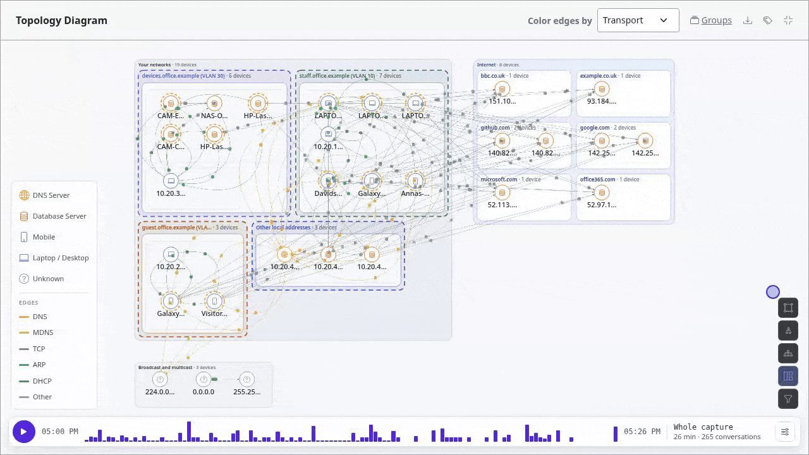
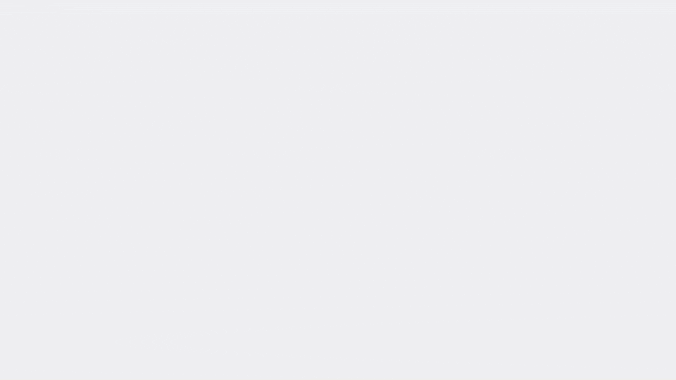
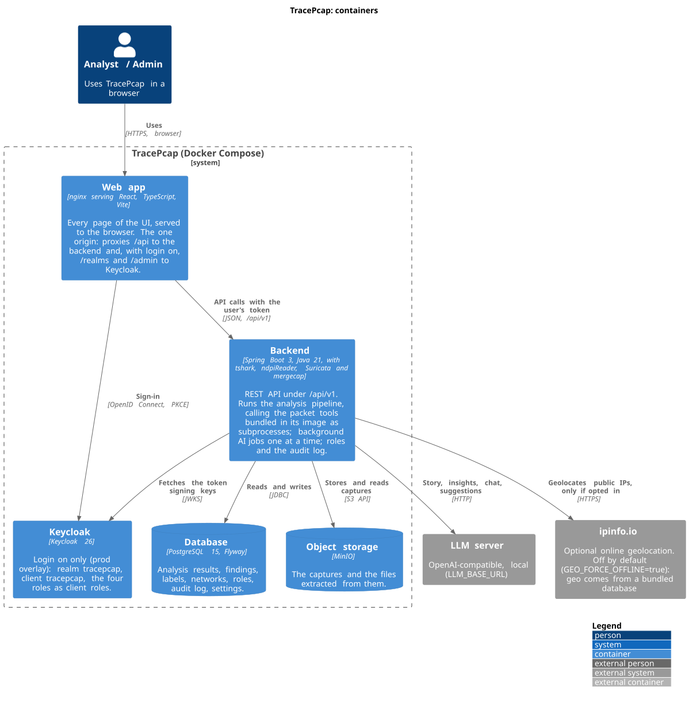

<h1 align="center">TracePcap</h1>

<p align="center">
  <strong>Self-hosted packet-capture analysis for black-box network forensics: reconstruct the devices, topology, sessions and threats of a network from its traffic alone.</strong>
</p>

<p align="center">
  <a href="#quick-start">Quick start</a> •
  <a href="#what-it-does">What it does</a> •
  <a href="#see-it-in-action">See it in action</a> •
  <a href="#how-it-works">How it works</a> •
  <a href="https://notyusheng.github.io/TracePcap">Documentation</a>
</p>

<p align="center">
  
  
  
  
  
  
</p>

<div align="center">

[](https://www.youtube.com/watch?v=9SYQsxG4QjI)

**[▶ Watch the demo on YouTube](https://www.youtube.com/watch?v=9SYQsxG4QjI)** (1 min 22 s)

</div>

---

**TracePcap** is for when all you have is the traffic: no documentation, no asset list, no prior
knowledge of the network. Upload packet captures and it works out which devices are there, what
each one is, who talked to whom, and what looks wrong. It can also track how a network changes
between captures, and an LLM can write up what happened. Everything runs on your own machine,
fully offline.

Use it for:

- **Network audits and third-party assessments:** handed a capture and nothing else, build the picture from scratch.
- **Incident response and forensics:** reconstruct what happened from packet evidence when records are incomplete.
- **Penetration-test reconnaissance:** map an unknown network from captured traffic.
- **Research and teaching:** explore any capture without context about where it came from.

## Quick start

You need **Docker with Docker Compose**, on amd64 or arm64 (including Apple Silicon), and at
least **8 GB of RAM** (6 GB with Suricata off).

```bash
git clone https://github.com/NotYuSheng/TracePcap.git
cd TracePcap
cp .env.example .env
docker compose up -d
```

Open **http://localhost** and drop in a capture (`.pcap`, `.pcapng` or `.cap`, up to 327 MB by
default). The first start takes a minute while the database and storage initialise.

**Next steps**

- **Turn on the AI features** (story, chat, insights): point `LLM_API_BASE_URL` in `.env` at a
  local or LAN OpenAI-compatible server such as LM Studio or Ollama, never a public API. Everything
  else works without one. See [LLM setup](https://notyusheng.github.io/TracePcap/configuration/llm-setup.html).
- **Turn on login** (Keycloak, with Viewer, Analyst, Lead and Admin roles) before more than one
  person uses it. See [Authentication](https://notyusheng.github.io/TracePcap/configuration/authentication.html).
- **Air-gapped machine?** See [Offline deployment](https://notyusheng.github.io/TracePcap/getting-started/offline-deployment.html).

<details>
<summary>Hardware sizing</summary>

| | Minimum | Recommended | Comfortable |
|---|---|---|---|
| RAM | 6 GB (`SURICATA_ENABLED=false`) | 8 GB+ | 16 GB |
| CPU | 4 cores | 4+ cores | 8 cores |
| Storage | 10 GB | 50 GB+ | 100 GB+ SSD |

This sizes the TracePcap stack only; a self-hosted LLM needs its own. The containers' limits total
about 4.4 GB (5.4 GB with login on). The upload limit follows `APP_MEMORY_MB`: about 16% of it, so
327 MB at the default 2048. See [Container resource limits](https://notyusheng.github.io/TracePcap/operations/production-hardening.html)
and [Supported CPU architectures](https://notyusheng.github.io/TracePcap/getting-started/supported-architectures.html).

</details>

## What it does

Every item links to its page in the [documentation](https://notyusheng.github.io/TracePcap).

**🔎 Discover: build an inventory from nothing**

- [Network map](https://notyusheng.github.io/TracePcap/features/network-visualization.html): devices grouped by network, played back over time, with filters by address, port, device type, protocol and risk.
- [Device classification](https://notyusheng.github.io/TracePcap/features/geolocation.html): router, server, IoT, phone, laptop and more, from behaviour, [manufacturer](https://notyusheng.github.io/TracePcap/features/mac-lookup.html) and [Windows sign-ins](https://notyusheng.github.io/TracePcap/features/windows-identity.html).
- [Devices on an address](https://notyusheng.github.io/TracePcap/features/address-reuse.html): tells apart devices that held the same IP in turn, and follows [devices that move](https://notyusheng.github.io/TracePcap/features/device-moves.html).
- [Where the traffic goes](https://notyusheng.github.io/TracePcap/features/traffic-groups.html): your networks, organisations and countries, from a bundled geolocation database.

**🔬 Inspect: see exactly what crossed the wire**

- [Conversations](https://notyusheng.github.io/TracePcap/features/conversations.html): every flow, filterable and sortable, exportable as PCAP or CSV.
- [Session reconstruction](https://notyusheng.github.io/TracePcap/features/session-reconstruction.html) and [packet replay](https://notyusheng.github.io/TracePcap/features/packet-replay.html): the payloads, in hex and text, step by step.
- [File extraction](https://notyusheng.github.io/TracePcap/features/file-extraction.html): files carried over HTTP and raw TCP/UDP streams.
- [Traffic over time](https://notyusheng.github.io/TracePcap/features/timeline-analysis.html), and [comparing captures](https://notyusheng.github.io/TracePcap/features/comparison.html) side by side.

**🛡️ Detect: surface threats and anomalies**

- [Suricata IDS](https://notyusheng.github.io/TracePcap/features/ids-threat-detection.html) alerts and [nDPI](https://notyusheng.github.io/TracePcap/features/ndpi-analysis.html) application, risk and TLS (JA3, SNI, certificate) analysis on every conversation.
- [Detection rules](https://notyusheng.github.io/TracePcap/features/custom-signatures.html) of your own, by address, port, JA3, hostname, app or payload pattern, for one capture, one network or everything.

**🤖 Narrate: plain language, from a local LLM (optional)**

- [Story](https://notyusheng.github.io/TracePcap/features/story-mode.html): who was attacked, who was signed in, what malware ran and where it called home, each answer with its evidence, then the whole story in order.
- [Ask about a capture](https://notyusheng.github.io/TracePcap/features/capture-chat.html): a chat that looks things up before answering and writes checked Wireshark filters.

**📈 Monitor: follow a network across captures**

- [Network monitor](https://notyusheng.github.io/TracePcap/features/network-monitor.html): add captures of the same network over time; each is compared with the one before (new devices, ARP and MAC drift, gateway, protocol and VPN changes), ranked by severity.

**Around all of it:** a [PDF report](https://notyusheng.github.io/TracePcap/features/report-export.html), [re-analysing](https://notyusheng.github.io/TracePcap/features/reanalysis.html) with other options, [roles and permissions](https://notyusheng.github.io/TracePcap/features/roles-and-permissions.html) with an audit log, and one [Settings](https://notyusheng.github.io/TracePcap/features/settings.html) page.

## See it in action

Two minutes through the main features: upload, the Overview, the flagged conversations, the
network map and one host's card, the story's four answers, the chat writing a filter for the C2
traffic, the report, and a monitored network changing over eight weeks.

<div align="center">

[](https://www.youtube.com/watch?v=9SYQsxG4QjI)

Click the GIF for the [full-quality video on YouTube](https://www.youtube.com/watch?v=9SYQsxG4QjI), with chapters and captions.

</div>

The capture is a real incident: a STRRAT remote-access trojan on a corporate LAN, from
malware-traffic-analysis.net's training exercises. Worked investigations, step by step:

- [STRRAT infection: "You dirty rat!"](https://notyusheng.github.io/TracePcap/demos/strrat-you-dirty-rat.html), checked against the exercise's answer key
- [Devices on a DHCP network: "Who was 10.0.0.50?"](https://notyusheng.github.io/TracePcap/demos/devices-on-a-dhcp-network.html)
- [Two sites, one range: telling networks apart](https://notyusheng.github.io/TracePcap/demos/two-sites-one-range.html)

## How it works

`docker compose` runs nginx (serving the React web app), a Spring Boot backend, PostgreSQL and
MinIO, plus Keycloak when login is on. The backend's image bundles **tshark**, **nDPI 6**,
**Suricata** and **mergecap**, and runs them on each capture.



- **Nothing leaves your machine.** Captures are stored and analysed locally. Geolocation comes from
  a bundled DB-IP database (online lookups are off unless you opt in with `GEO_FORCE_OFFLINE=false`),
  and the LLM, if you use one, must be local or on your LAN. It's sent findings, not raw packets.
- **Login is optional.** The base stack runs open, for one person. With login on, Keycloak decides
  who may sign in and which role they have; TracePcap decides what each role may do.

More in [System architecture](docs/architecture/c4.rst) and the
[five-stage pipeline](https://notyusheng.github.io/TracePcap/architecture/layers.html).

## Security

- **Turn on login before sharing it.** The base stack has no authentication; anyone who can reach
  it can use it. See [Authentication](https://notyusheng.github.io/TracePcap/configuration/authentication.html),
  and **change every default credential** in `.env` for a real deployment.
- **Roles** limit what each person may do (upload, ask the AI, export packets, delete others'
  captures, change settings), and changes are recorded in an audit log. Everyone who can sign in
  can see every capture.
- **PostgreSQL (5432) and the MinIO console (9001) are published on the host** by every stack.
  Firewall them, or remove those ports, on any machine others can reach; see
  [Production hardening](https://notyusheng.github.io/TracePcap/operations/production-hardening.html).

## Documentation

Everything is at **https://notyusheng.github.io/TracePcap**:

- **Getting started:** [installation](https://notyusheng.github.io/TracePcap/getting-started/installation.html), [offline deployment](https://notyusheng.github.io/TracePcap/getting-started/offline-deployment.html)
- **Configuration:** [environment variables](https://notyusheng.github.io/TracePcap/configuration/environment-variables.html), [LLM setup](https://notyusheng.github.io/TracePcap/configuration/llm-setup.html), [authentication](https://notyusheng.github.io/TracePcap/configuration/authentication.html), [users and roles](https://notyusheng.github.io/TracePcap/configuration/user-management.html), [detection rules](https://notyusheng.github.io/TracePcap/configuration/signature-rules.html)
- **Operations:** [production hardening](https://notyusheng.github.io/TracePcap/operations/production-hardening.html), [backup and restore](https://notyusheng.github.io/TracePcap/operations/backup-restore.html), [logs and monitoring](https://notyusheng.github.io/TracePcap/operations/logs-monitoring.html)

The REST API is described at `/swagger-ui/index.html` on a running instance (off in the production
overlay), and in [`openapi/baseline.json`](openapi/baseline.json).

## Sample captures

[`sample-files/`](sample-files/) has captures to try, most with the `gen_*.py` script that made them:

- `office_showcase.pcap`: a small office (four VLANs) plus the cases the network map shows best, good for a first look
- `demo_all_rules.pcap`: triggers every rule in [`signatures.sample.yml`](signatures.sample.yml)
- `dhcp_address_reuse.pcap`, `device_roaming.pcap`, `site_to_site_vpn.pcap`: the device-identity cases from the docs' worked investigations
- `monitor_large/`: eight weekly captures of a simulated 550-device network, for the network monitor
- `free5gc.pcap` (5G core traffic), and protocol samples: `ftp.pcap`, `signal.pcap`, `discord.pcap`

## Contributing

See [CONTRIBUTING.md](CONTRIBUTING.md). Branch from `dev` and open pull requests against `dev`.

## Star history

<a href="https://www.star-history.com/?type=date&repos=NotYuSheng%2FTracePcap">
 <picture>
   <source media="(prefers-color-scheme: dark)" srcset="https://api.star-history.com/chart?repos=NotYuSheng/TracePcap&type=date&theme=dark&legend=top-left&sealed_token=D9LPtWzHI5tnKqoizk26myDmStDNwaytLiuCwkJKxwX7MzFH4ohD0wndbvmqPTyMMgETf436S_A9Rn9P6oUJg0G90ahClkr_pehyp6Ka7gHIXUjxbpQDiBlxtg6UmTpTHVZGfAYIFWBPTLmPxFIGtV6WXBbEX3nFrriIph2g7prnmubhH7xBaxldvq8s" />
   <source media="(prefers-color-scheme: light)" srcset="https://api.star-history.com/chart?repos=NotYuSheng/TracePcap&type=date&legend=top-left&sealed_token=D9LPtWzHI5tnKqoizk26myDmStDNwaytLiuCwkJKxwX7MzFH4ohD0wndbvmqPTyMMgETf436S_A9Rn9P6oUJg0G90ahClkr_pehyp6Ka7gHIXUjxbpQDiBlxtg6UmTpTHVZGfAYIFWBPTLmPxFIGtV6WXBbEX3nFrriIph2g7prnmubhH7xBaxldvq8s" />
   
 </picture>
</a>

## License

MIT. See [LICENSE](LICENSE).
