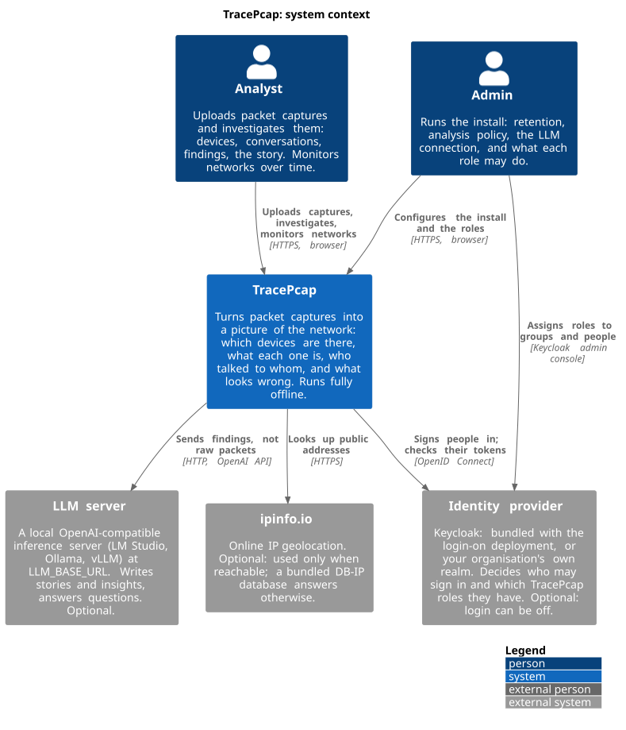
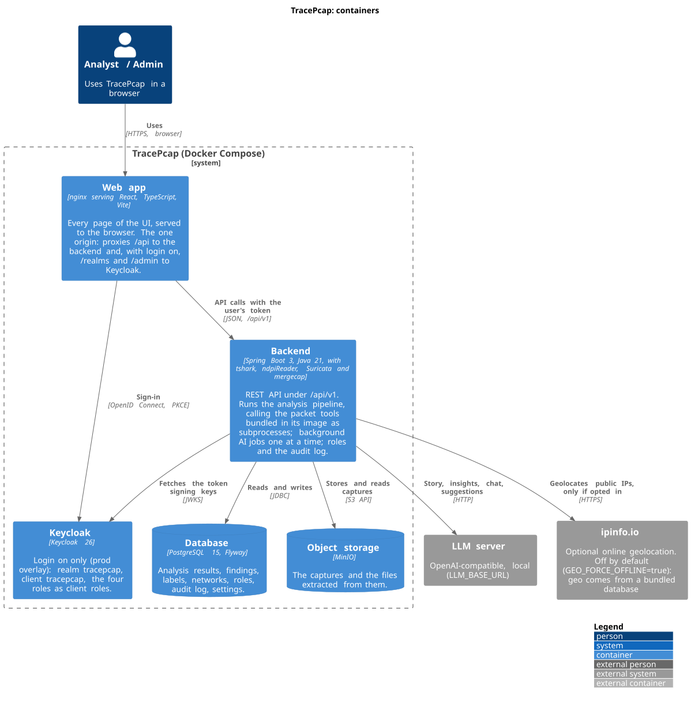
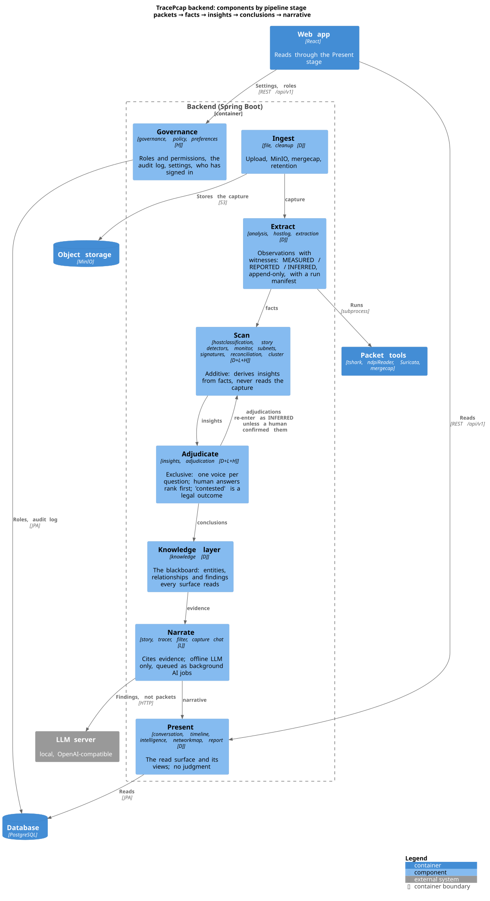

System Architecture (C4)
========================

TracePcap's architecture drawn with the `C4 model <https://c4model.com>`_, from the outside in:
who uses it and what it talks to (context), what runs where (containers), and how the backend is
organised (components). Each level zooms into one box of the level above. Click a diagram to
open it full size.

.. contents::
   :local:
   :depth: 1

Level 1: System context
-----------------------

         provider, an LLM server and ipinfo.io, all optional
   :width: 80%

TracePcap runs fully offline. Everything it talks to outside itself is **optional**:

- **Identity provider.** Keycloak decides who may sign in and which roles they have. It's bundled
  with the login-on deployment, or it can be your organisation's own realm (see
  :doc:`../configuration/authentication`). With login off there's no identity provider at all.
- **LLM server.** A local, OpenAI-compatible inference server writes stories and insights and
  answers questions. It's sent findings, never raw packets. Without one, everything else works
  (see :doc:`../configuration/llm-setup`).
- **ipinfo.io.** Used for geolocation only when it's reachable; a bundled DB-IP database answers
  otherwise (see :doc:`../features/geolocation`).

Level 2: Containers
-------------------

         tools, PostgreSQL, MinIO, and Keycloak when login is on
   :width: 100%

What ``docker compose`` runs. The base stack is ``docker-compose.yml``; turning login on adds
Keycloak from ``docker-compose.prod.yml``.

.. list-table::
   :header-rows: 1
   :widths: 20 25 55

   * - Container
     - Technology
     - What it does
   * - Web server
     - nginx
     - Serves the web app and is the single origin the browser talks to: ``/api`` goes to the
       backend and, with login on, ``/realms`` and ``/admin`` go to Keycloak. One origin means no
       CORS and one ``PUBLIC_URL``.
   * - Web app
     - React, TypeScript, Vite
     - Runs in the browser. Calls ``/api/v1`` with the signed-in user's token.
   * - Backend
     - Spring Boot 3, Java 21
     - The REST API, the analysis pipeline, background AI jobs (one at a time for the model),
       roles and the audit log. Its parts are on Level 3.
   * - Packet tools
     - tshark, ndpiReader, Suricata, mergecap
     - Run as subprocesses inside the backend's container. They're the only code that reads the
       capture itself.
   * - Database
     - PostgreSQL 15, Flyway
     - Analysis results, findings, labels, networks, roles, the audit log and settings.
   * - Object storage
     - MinIO
     - The captures, and the files extracted from them.
   * - Keycloak
     - Keycloak 26
     - Login on only: realm ``tracepcap``, client ``tracepcap``, the four roles as client roles
       (see :doc:`../features/roles-and-permissions`).

``docker-compose.yml`` also runs two one-shot helpers, ``minio-volume-perms`` and ``minio-init``,
which prepare the storage volume and bucket and then exit. They're left off the diagram.

Level 3: Backend components
---------------------------

         Adjudicate, the knowledge layer, Narrate and Present, plus Governance
   :width: 75%

The backend is organised as a pipeline. Data changes shape at each stage: packets → facts →
insights → conclusions → narrative. Each box is a stage, and the modules in it are the Java
packages under ``com.tracepcap``. The tags say how each stage works: **D** deterministic, **L**
LLM-driven, **H** human-annotated.

What each stage may and may not do, and how the boundaries are enforced, is in
:doc:`layers` and :doc:`enforcement`. The knowledge layer is described in :doc:`knowledge-layer`.

.. _c4-editing:

Editing the diagrams
--------------------

The sources are PlantUML files in ``docs/architecture/c4/``, with the rendered SVG committed next
to each one:

.. code-block:: bash

   # after editing a .puml
   scripts/render-diagrams.sh

The script runs a pinned PlantUML image in Docker (no Java needed) with networking off. CI runs
``scripts/render-diagrams.sh --check`` and fails if a committed SVG doesn't match its source.

Two rules keep the diagrams working offline and stable:

- **Include the C4 library from PlantUML itself**, ``!include <C4/C4_Container>``, never
  ``!includeurl https://raw.githubusercontent.com/...``. The library ships inside PlantUML; the URL
  form needs the internet to render and follows whatever upstream changes.
- **No version number in the title.** Git already versions each file; a hand-typed version goes
  stale.
