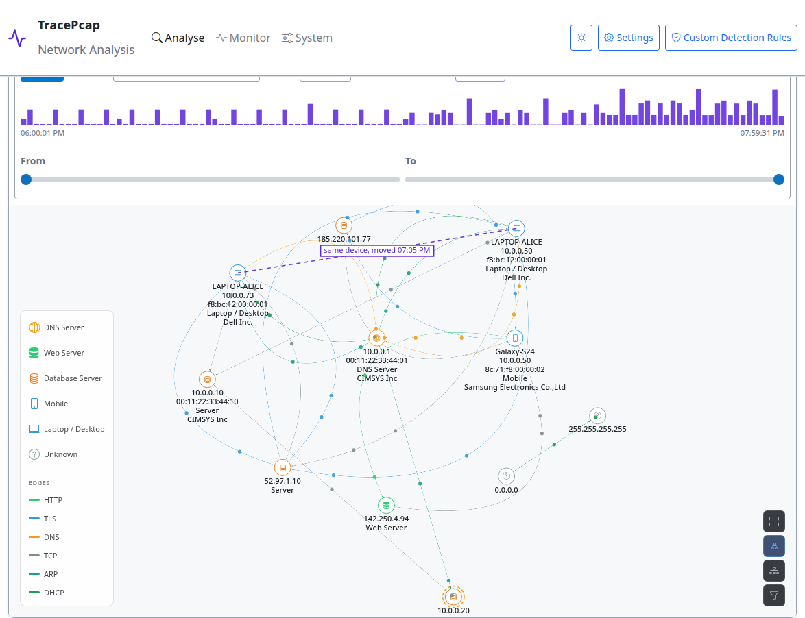
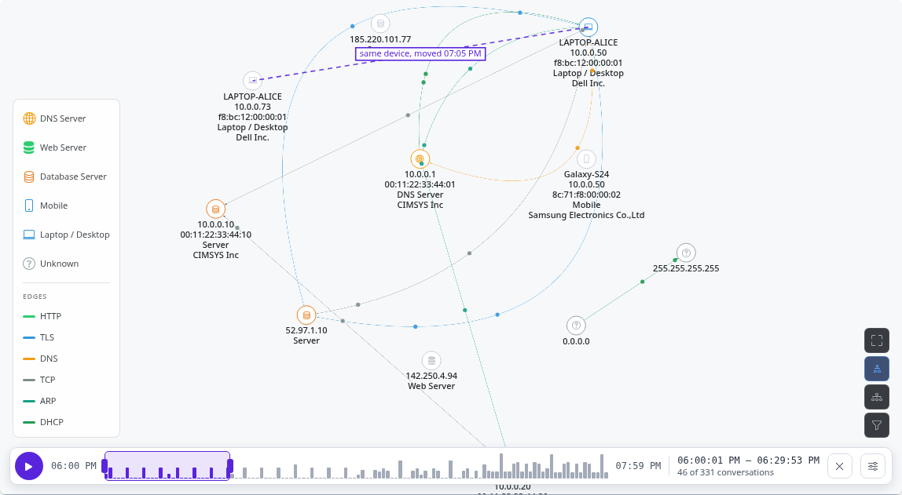
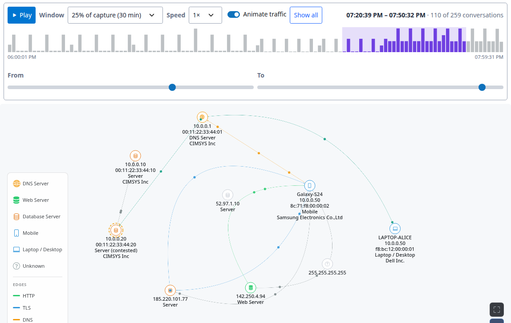
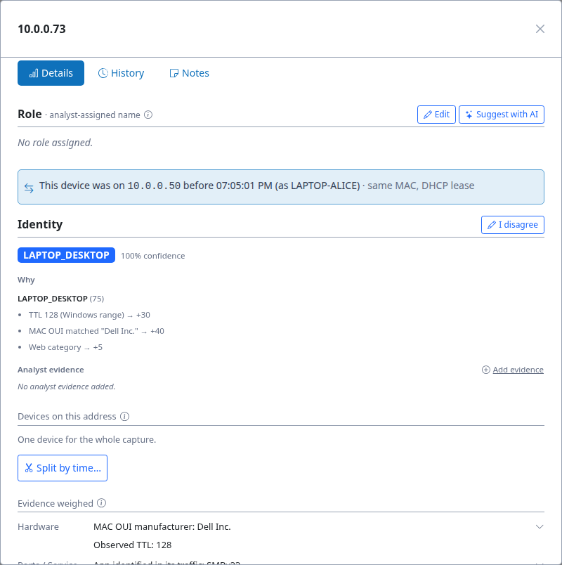
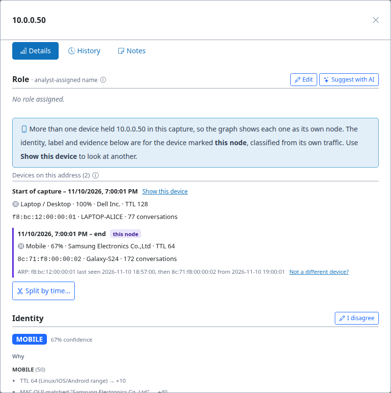
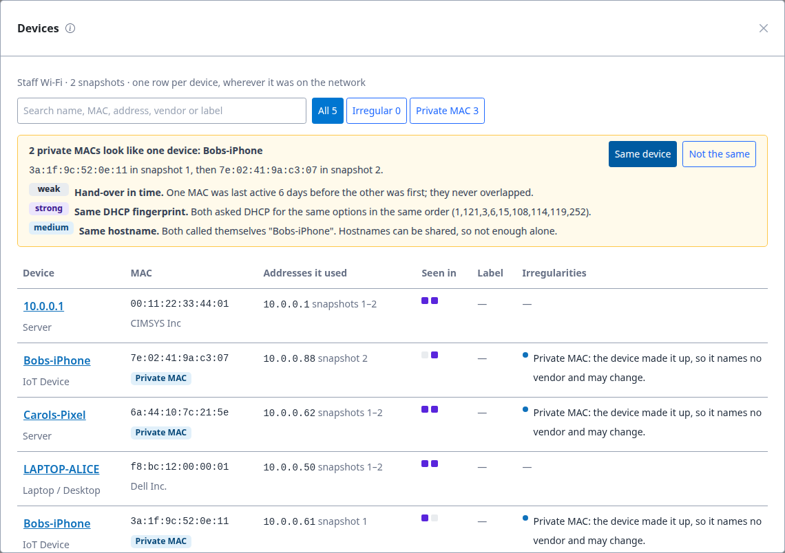
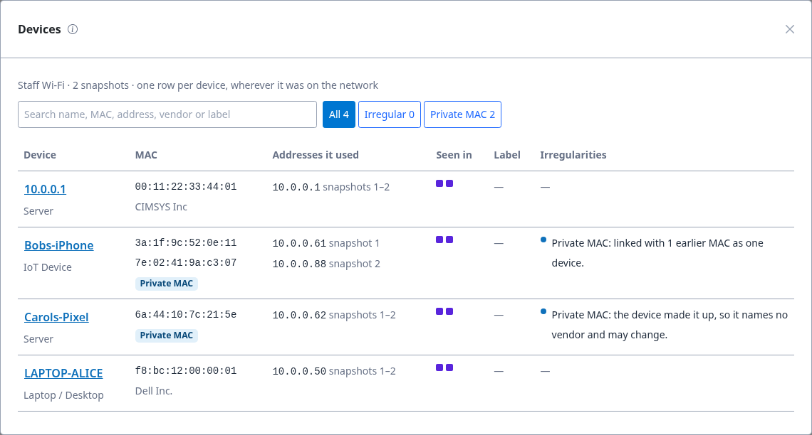

Devices on a DHCP network: "Who was 10.0.0.50?"
================================================

.. note::

   **Captured against TracePcap** ``v0.2.0-338`` **(dev, 14 November 2026).** TracePcap changes
   quickly, so this walkthrough is a point-in-time record. Which device held which address, and the
   evidence for it, are stable across versions; screenshots, confidence figures and UI details
   reflect *that* build, and a later one may differ. Re-verify against the current build before
   quoting a specific figure.

On networks that hand out addresses by DHCP, an IP address is not a device. A laptop leaves, its
lease ends, and the next phone to join gets the same address. Phones also make up their own MAC
address and can change it. This walkthrough shows how TracePcap works out **which device** did
something, using two synthetic captures from ``sample-files/`` (see :doc:`../sample-files`).

Part 1: one address, two devices
--------------------------------

**The capture:** ``dhcp_address_reuse.pcap``, office Wi-Fi from 10:00 to 12:00.

.. list-table::
   :header-rows: 1
   :widths: 22 78

   * - Time
     - What happens
   * - 10:00
     - Alice's Dell laptop is leased ``10.0.0.50`` as ``LAPTOP-ALICE``. It reads mail and uses the
       file share.
   * - 10:59
     - The laptop releases the address and leaves.
   * - 11:00
     - A visitor's Samsung phone is leased the same ``10.0.0.50`` as ``Galaxy-S24``.
   * - 11:05
     - Alice's laptop comes back and gets a **new** address, ``10.0.0.73``.
   * - 11:32
     - The phone starts **beaconing** to ``update-check.cdn-telemetry.top`` once a minute.

The question an analyst gets: *the beacon came from 10.0.0.50. Whose machine is it?* By address
alone, the answer is "LAPTOP-ALICE": that's the name the address had first, and an address-keyed
tool blames Alice.

**What TracePcap shows.** Upload the capture and open **Network Visualization**. ``10.0.0.50`` is
**two nodes**, one per device, each classified from its own traffic:

         and Galaxy-S24 (Mobile, Samsung).

   ``LAPTOP-ALICE`` (Laptop / Desktop, Dell, TTL 128) and ``Galaxy-S24`` (Mobile, Samsung, TTL 64)
   both on ``10.0.0.50``. The beacon's edges, to ``185.220.101.77``, are on the phone. The dashed
   line joins the laptop's two nodes: it moved to ``10.0.0.73`` at 11:05.

Each conversation goes to the device that held the address when it started, so the beacon lands on
the phone and Alice's laptop is clean.

**Watch it happen.** The time axis above the graph picks a window of the capture, and dots move
along the conversations active in it (see :doc:`../features/network-time-axis`). Click early in the
chart, or press **Play**:

         with its mail and file-share conversations; the phone and the beacon server are greyed out.

   Early on, only the laptop holds ``10.0.0.50``: its mail and file-share traffic is drawn, and the
   phone and ``185.220.101.77`` are greyed out.

         its beacon to 185.220.101.77 and its Google traffic; the laptop's traffic is gone.

   Late in the capture the phone holds it, and its beaconing to ``185.220.101.77`` shows up.

**The laptop moved, too.** When Alice came back she got ``10.0.0.73``. Same MAC, new DHCP lease:
TracePcap links the two nodes as one device, and the new address's details say where it came from
(see :doc:`../features/device-moves`):

         LAPTOP-ALICE), same MAC, DHCP lease", above its identity.

   ``10.0.0.73`` is Alice's laptop, back on a new lease.

**Why TracePcap split it.** Click the phone's node. Under **Devices on this address**:

         "this node", with each one's own type, vendor, TTL and conversations, and the ARP evidence
         for the change.

   Two devices, each with its own verdict (``Mobile · 67% · Samsung · TTL 64`` for the phone). The
   change is backed by evidence: *ARP: f8:bc:12:… last seen 18:57, then 8c:71:f8:… from 19:00.*

- An address is split **only when a different MAC takes it over** (ARP or DHCP). A TTL or hostname
  change alone isn't enough: one machine rebooting into another OS looks the same.
- The **Identity**, label, role and evidence below the list are **this device's**. Label the
  phone "Visitor phone, suspicious" and the laptop doesn't get it.
- If the split is wrong (a phone rotating its MAC), **Not a different device?** merges it back.
  If a split is missing (cloned VMs with one MAC), **Split by time…** adds one. Both are audited
  and can be undone.

Details: :doc:`../features/address-reuse`.

Part 2: the same phone, a different MAC
---------------------------------------

**The captures:** ``private_mac_week1.pcap`` and ``private_mac_week2.pcap``, two weekly snapshots of
staff Wi-Fi, added in order to one monitored network ("Staff Wi-Fi").

iPhones (iOS 14+) and Android phones (10+) use a **private MAC** per Wi-Fi network by default, and
newer versions can change it. Between the weeks, Bob's iPhone did: ``3a:1f:9c:…`` in week 1,
``7e:02:41:…`` in week 2. Carol's Pixel kept its private MAC.

**What TracePcap shows.** On the network's page, open **Devices**:

         Bobs-iPhone, with weak, strong and medium evidence. Below, one row per MAC.

   One row per MAC across both snapshots. At the top, a **suggestion**: the two private MACs look
   like one device.

The suggestion grades its evidence:

- **Strong:** the same **DHCP fingerprint**, the options asked for in the same order. It names the
  OS and often the model, and stays the same when the MAC changes.
- **Medium:** the same hostname, ``Bobs-iPhone``. Hostnames can be shared, so not enough alone.
- **Weak:** the hand-over in time. One MAC stopped about 6 days before the other began, and they
  never overlapped.

Carol's Pixel is **not** suggested: its DHCP fingerprint differs, and it was active at the same time
as Bob's second MAC. Two devices active at once can't be one.

Nothing is linked automatically. **Same device** asks for a reason, then shows the two MACs as one
device, with both addresses and both snapshots:

   ``Bobs-iPhone`` is one device across both snapshots. The link is audited and can be undone from
   the device's details.

.. note::

   Both phones are classified weakly ("IoT Device", "Server"). With a private MAC the classifier
   loses the vendor, its strongest clue, and these synthetic captures carry little else. On real
   traffic, TLS fingerprints (from nDPI) and app traffic add evidence.

The Devices list also flags MACs that may not stand for one machine: **duplicate MACs** (one MAC
answering as two operating systems at once), **virtual machine** and **container** MACs. Details:
:doc:`../features/network-devices`.

Reproducing it
--------------

.. code-block:: bash

   python3 sample-files/gen_dhcp_reuse.py            # dhcp_address_reuse.pcap
   python3 sample-files/gen_private_mac_rotation.py  # private_mac_week1.pcap, private_mac_week2.pcap

1. Upload ``dhcp_address_reuse.pcap`` and open **Network Visualization**.
2. Upload the two weekly captures **one after the other**. On **Monitor**, create a network and add
   week 1, then week 2, as snapshots. Open **Devices**.
