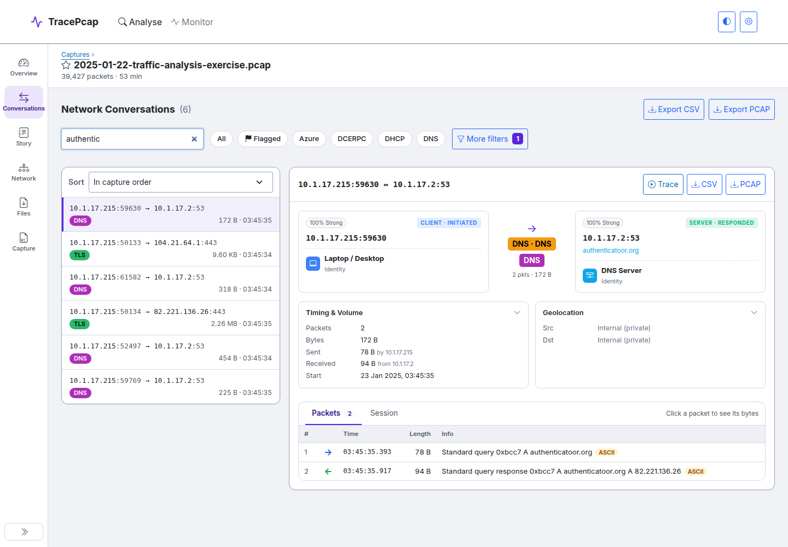
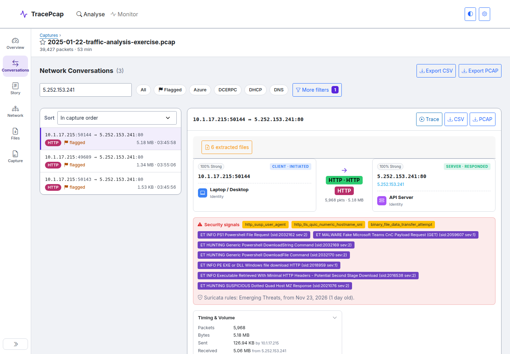
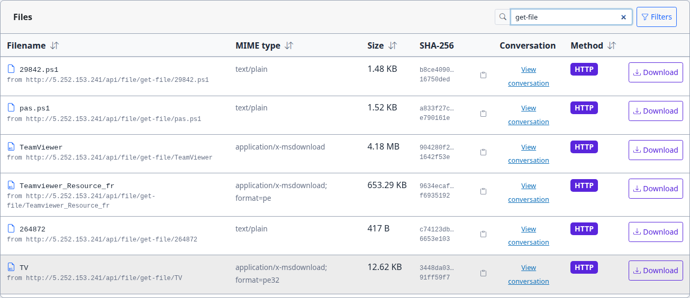

Download from a fake software site
==================================

.. note::

   **Captured against TracePcap** ``v0.5.0-70`` **(dev, 25 November 2026)**. TracePcap changes quickly, so this
   walkthrough is a point-in-time record: the deterministic conclusions are stable, but screenshots,
   counts and UI details reflect that build. Re-verify against the current build before quoting a
   figure.

A user searched for Google Authenticator, landed on a fake download page from a malicious ad, and ran
what it gave them. This one is harder than the others: no IDS rule names the malware family (the
answer key doesn't know it either), and two of its three command-and-control servers trip no
behavioural rule at all. It shows what TracePcap concludes, what it surfaces for an analyst to
decide, and where it deliberately stops.

The exercise
------------

`malware-traffic-analysis.net <https://www.malware-traffic-analysis.net/>`_'s
`2025-01-22 exercise <https://www.malware-traffic-analysis.net/2025/01/22/index.html>`_, based on a
malicious ad Unit 42 reported on that day.

What you are given
------------------

.. list-table::
   :header-rows: 1
   :widths: 32 68

   * - Given
     - Value
   * - LAN segment
     - ``10.1.17.0/24`` (gateway ``10.1.17.1``)
   * - Active Directory domain
     - ``bluemoontuesday.com`` (``BLUEMOONTUESDAY``)
   * - Domain controller
     - ``10.1.17.2`` (``WIN-GSH54QLW48D``)
   * - The task
     - The infected client's IP, MAC, host name and user account; the likely domain of the fake
       Google Authenticator page; the IP addresses of the C2 servers.

The capture isn't committed to this repository; get it from the exercise page (ZIP password
``infected_20250122``, following the site's scheme).

Walking it through TracePcap
----------------------------

Step 1 — Upload and analyse
~~~~~~~~~~~~~~~~~~~~~~~~~~~

Upload with **Intrusion alerts (Suricata)** and **Files in the traffic** ticked.

Step 2 — The Investigation Summary
~~~~~~~~~~~~~~~~~~~~~~~~~~~~~~~~~~

.. figure:: images/mta-fake-authenticator-summary.png
   :alt: Investigation Summary: victim, user, a C2 and two suspected C2s, downloads and TeamViewer
   :width: 60%

   The summary names the victim, one C2 and two suspected C2s, lists what the host downloaded with
   hashes, and flags a remote-access tool. It says plainly that the malware family isn't established.

.. list-table::
   :header-rows: 1
   :widths: 20 52 12 16

   * - Question
     - Answer
     - Grade
     - From
   * - Signed-in user
     - ``shutchenson`` (Steve Hutchenson) on ``10.1.17.215``
     - MEASURED
     - Kerberos sign-in; full name from the domain controller
   * - Victim host
     - ``10.1.17.215``, which contacted the C2
     - INFERRED
     - contacted a C2
   * - Command & control
     - ``5.252.153.241`` (NL), *C2 for unidentified malware (the rule names no family)*, first
       contacted 2025-01-22 19:45:56 UTC
     - INFERRED
     - IDS
   * - Command & control
     - ``45.125.66.32`` and ``45.125.66.252`` (LT), *suspected C2 for unidentified malware*, first
       contacted 19:59:46 and 20:00:13 UTC
     - INFERRED
     - reputation + behaviour (below)
   * - Downloaded files
     - ``TeamViewer`` (4.4 MB), ``Teamviewer_Resource_fr`` (669 KB) and ``TV`` (13 KB), Windows
       programs from ``http://5.252.153.241/api/file/get-file/…``, each with its SHA-256; and
       *2 more files* (the PowerShell scripts, folded as the smaller ones)
     - MEASURED
     - HTTP transfer
   * - Remote-access tool
     - ``10.1.17.215`` runs TeamViewer, talking to ``185.188.32.26`` since 19:55:07 UTC; *confirm
       it's sanctioned*
     - INFERRED
     - IDS (TeamViewer user agent)
   * - Malware
     - *Not established for this capture*
     - —
     - —

**A C2 without a family.** The one malware rule that fired is *ET MALWARE Fake Microsoft Teams CnC
Payload Request*. ET tags it with no ``malware_family``, and it names a lure, not a family. TracePcap
still treats the server as a C2 (the rule is about command and control), which is what identifies the
victim, but it never claims a family. The answer key says the same: "I'm not sure what this malware
is called, but it's clearly malicious."

**The rest of the story is in the downloads.** The C2 served the host a TeamViewer bundle, and ten
minutes later the host was running TeamViewer against an outside server. Remote-access tools are a
common way for this kind of malware to hand the machine to a person.

Step 3 — Finding the fake site
~~~~~~~~~~~~~~~~~~~~~~~~~~~~~~

TracePcap doesn't conclude which page started the infection: the site served its download over HTTPS
and tripped no rule. But the analyst's search reaches it in one step. The Conversations search box
matches server names as well as addresses, so searching for *authentic* finds it:

   Six conversations: DNS lookups and TLS sessions for ``google-authenticator.burleson-appliance.net``
   (``104.21.64.1``) and ``authenticatoor.org`` (``82.221.136.26``), the second carrying 2.26 MB.
   Times on screen are in the server's zone (UTC+8 here).

Step 4 — The C2 and its files
~~~~~~~~~~~~~~~~~~~~~~~~~~~~~

   A session with ``5.252.153.241``, flagged by the *Fake Microsoft Teams CnC Payload Request* rule.

   Searching Files for ``get-file``: everything the C2 served, with URLs and hashes. Two PowerShell
   scripts (``29842.ps1``, ``pas.ps1``), the three TeamViewer programs, and a small text response.

Checked against the answer key
------------------------------

.. list-table::
   :header-rows: 1
   :widths: 26 34 30 10

   * - Question
     - Answer key
     - TracePcap
     - Match
   * - IP address
     - ``10.1.17.215``
     - ``10.1.17.215``
     - ✓
   * - MAC address
     - ``00:d0:b7:26:4a:74``
     - ``00:d0:b7:26:4a:74``
     - ✓
   * - Host name
     - ``DESKTOP-L8C5GSJ``
     - ``DESKTOP-L8C5GSJ``
     - ✓
   * - User account
     - ``shutchenson``
     - ``shutchenson``
     - ✓
   * - Fake software site
     - ``authenticatoor.org``
     - found by the analyst's search (Step 3), not concluded
     - ~
   * - C2 servers
     - ``5.252.153.241``, ``45.125.66.32``, ``45.125.66.252``
     - all three: the first by rule, the other two as *suspected*
     - ✓

**The PowerShell scripts.** ``29842.ps1`` and ``pas.ps1`` are plain text (``text/plain``), so their
content doesn't say what they are. TracePcap also reads a script's file name (``.ps1``, ``.js``,
``.vbs``, ``.hta``, ``.bat``), so they count as downloads; the summary lists the three largest files
from a server and folds the rest as *2 more files*, with all of them under Files. The sixth file
under Files, ``264872``, is a 417-byte text response with no script name, so it isn't counted as a
download.

**How the other two C2s are found.** The only alert on ``45.125.66.32`` and ``45.125.66.252`` is
*ET DROP Spamhaus DROP Listed Traffic*: the addresses are in a netblock run by criminals. That's
reputation, not behaviour, and plenty of traffic to such space is scanning or spam, so TracePcap
doesn't call a server a C2 on reputation alone. Here there's more. Starting 14 minutes after the
confirmed C2, the already-infected host reaches ``45.125.66.32`` in three separate rounds (19:59,
20:25, 20:28 UTC), each the same three TLS sessions to a bare IP on the unusual port 2917, and in
every round ``45.125.66.252`` seconds later. TracePcap's rule for this combines all of it: *a
reputation-listed bare IP that an already-infected host reaches in repeated rounds is a suspected
C2*. The answer says *suspected*, is graded INFERRED, and **How we got here** shows the rule and the
evidence.

What this demonstrates
----------------------

A hard case handled honestly: the victim, the user and all three C2s found, with the two that only
reputation and behaviour point to marked *suspected*; the payload's files with hashes; a
remote-access tool flagged for review; the fake site one search away. And nothing asserted beyond
the evidence: no invented family, and no C2 on reputation alone.
