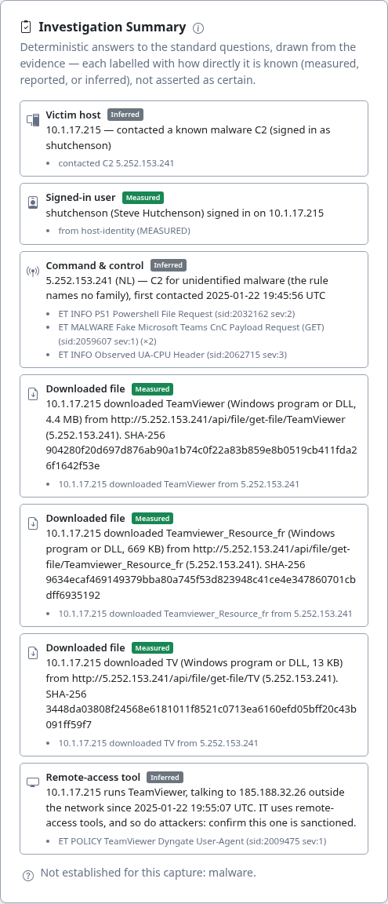

Download from a fake software site
==================================

.. note::

   **Captured against TracePcap** ``v0.5.0`` **(dev, 22 November 2026)**, including the conversation
   grouping fix (#1257) and per-direction byte counts (#1260). TracePcap changes quickly, so this
   walkthrough is a point-in-time record: the deterministic conclusions are stable, but screenshots,
   counts and UI details reflect that build. Re-verify against the current build before quoting a
   figure.

A user searched for Google Authenticator, landed on a fake download page from a malicious ad, and ran
what it gave them. This one is harder than the others: no IDS rule names the malware family (the
answer key doesn't know it either), and two of its three command-and-control servers trip no
behavioural rule at all. It shows what TracePcap concludes, what it surfaces for an analyst to
decide, and where it deliberately stops.

The exercise
------------

`malware-traffic-analysis.net <https://www.malware-traffic-analysis.net/>`_'s
`2025-01-22 exercise <https://www.malware-traffic-analysis.net/2025/01/22/index.html>`_, based on a
malicious ad Unit 42 reported on that day.

What you are given
------------------

.. list-table::
   :header-rows: 1
   :widths: 32 68

   * - Given
     - Value
   * - LAN segment
     - ``10.1.17.0/24`` (gateway ``10.1.17.1``)
   * - Active Directory domain
     - ``bluemoontuesday.com`` (``BLUEMOONTUESDAY``)
   * - Domain controller
     - ``10.1.17.2`` (``WIN-GSH54QLW48D``)
   * - The task
     - The infected client's IP, MAC, host name and user account; the likely domain of the fake
       Google Authenticator page; the IP addresses of the C2 servers.

The capture isn't committed to this repository; get it from the exercise page (ZIP password
``infected_20250122``, following the site's scheme).

Walking it through TracePcap
----------------------------

Step 1 — Upload and analyse
~~~~~~~~~~~~~~~~~~~~~~~~~~~

Upload with **Intrusion alerts (Suricata)** and **Files in the traffic** ticked.

Step 2 — The Investigation Summary
~~~~~~~~~~~~~~~~~~~~~~~~~~~~~~~~~~

   The summary names the victim and one C2, lists what the host downloaded from it with hashes, and
   flags a remote-access tool. It says plainly that the malware family isn't established.

.. list-table::
   :header-rows: 1
   :widths: 20 52 12 16

   * - Question
     - Answer
     - Grade
     - From
   * - Signed-in user
     - ``shutchenson`` (Steve Hutchenson) on ``10.1.17.215``
     - MEASURED
     - Kerberos sign-in; full name from the domain controller
   * - Victim host
     - ``10.1.17.215``, which contacted the C2
     - INFERRED
     - contacted a C2
   * - Command & control
     - ``5.252.153.241`` (NL), *C2 for unidentified malware (the rule names no family)*, first
       contacted 2025-01-22 19:45:56 UTC
     - INFERRED
     - IDS
   * - Downloaded files
     - ``TeamViewer`` (4.4 MB), ``Teamviewer_Resource_fr`` (669 KB) and ``TV`` (13 KB), Windows
       programs from ``http://5.252.153.241/api/file/get-file/…``, each with its SHA-256
     - MEASURED
     - HTTP transfer
   * - Remote-access tool
     - ``10.1.17.215`` runs TeamViewer, talking to ``185.188.32.26`` since 19:55:07 UTC; *confirm
       it's sanctioned*
     - INFERRED
     - IDS (TeamViewer user agent)
   * - Malware
     - *Not established for this capture*
     - —
     - —

**A C2 without a family.** The one malware rule that fired is *ET MALWARE Fake Microsoft Teams CnC
Payload Request*. ET tags it with no ``malware_family``, and it names a lure, not a family. TracePcap
still treats the server as a C2 (the rule is about command and control), which is what identifies the
victim, but it never claims a family. The answer key says the same: "I'm not sure what this malware
is called, but it's clearly malicious."

**The rest of the story is in the downloads.** The C2 served the host a TeamViewer bundle, and ten
minutes later the host was running TeamViewer against an outside server. Remote-access tools are a
common way for this kind of malware to hand the machine to a person.

Step 3 — Finding the fake site
~~~~~~~~~~~~~~~~~~~~~~~~~~~~~~

TracePcap doesn't conclude which page started the infection: the site served its download over HTTPS
and tripped no rule. But the analyst's search reaches it in one step. The Conversations search box
matches server names as well as addresses, so searching for *authentic* finds it:

.. figure:: images/mta-fake-authenticator-pivot.png
   :alt: Searching conversations for "authentic" finds the fake Google Authenticator domains
   :width: 100%

   Six conversations: DNS lookups and TLS sessions for ``google-authenticator.burleson-appliance.net``
   (``104.21.64.1``) and ``authenticatoor.org`` (``82.221.136.26``), the second carrying 2.26 MB.
   Times on screen are in the server's zone (UTC+8 here).

Step 4 — The C2 and its files
~~~~~~~~~~~~~~~~~~~~~~~~~~~~~

.. figure:: images/mta-fake-authenticator-conversation.png
   :alt: A conversation with the C2 5.252.153.241
   :width: 100%

   A session with ``5.252.153.241``, flagged by the *Fake Microsoft Teams CnC Payload Request* rule.

.. figure:: images/mta-fake-authenticator-files.png
   :alt: The three TeamViewer files from the C2 in the Files tab
   :width: 100%

   Searching Files for ``get-file``: everything the C2 served, with URLs and hashes. Two PowerShell
   scripts (``29842.ps1``, ``pas.ps1``), the three TeamViewer programs, and a small text response.

Checked against the answer key
------------------------------

.. list-table::
   :header-rows: 1
   :widths: 26 34 30 10

   * - Question
     - Answer key
     - TracePcap
     - Match
   * - IP address
     - ``10.1.17.215``
     - ``10.1.17.215``
     - ✓
   * - MAC address
     - ``00:d0:b7:26:4a:74``
     - ``00:d0:b7:26:4a:74``
     - ✓
   * - Host name
     - ``DESKTOP-L8C5GSJ``
     - ``DESKTOP-L8C5GSJ``
     - ✓
   * - User account
     - ``shutchenson``
     - ``shutchenson``
     - ✓
   * - Fake software site
     - ``authenticatoor.org``
     - found by the analyst's search (Step 3), not concluded
     - ~
   * - C2 servers
     - ``5.252.153.241``, ``45.125.66.32``, ``45.125.66.252``
     - ``5.252.153.241`` only
     - 1 of 3

**Why the PowerShell scripts aren't in the summary.** The *Downloaded file* answer picks files by
their detected content type, and a PowerShell script's content is plain text (``text/plain``), so
``29842.ps1`` and ``pas.ps1`` are listed under Files but not among the answers. Considering a script's
file name (``.ps1``, ``.js``, ``.vbs``, ``.hta``, ``.bat``) as well is a straightforward improvement.

**Why two C2s are missed.** The only alert on ``45.125.66.32`` and ``45.125.66.252`` is *ET DROP
Spamhaus DROP Listed Traffic*: the addresses are in a netblock run by criminals. That's reputation,
not behaviour; plenty of traffic to such space is scanning or spam. TracePcap doesn't call a server a
C2 on reputation alone. The capture does hold more: the host pulled 10 MB from ``45.125.66.32``,
including a DLL. A rule that combines those signals (an already-infected host, a DROP-listed server,
executables from it) is a candidate improvement, graded INFERRED with the chain as its evidence.

What this demonstrates
----------------------

A hard case handled honestly: the victim, the user and one C2 concluded; the payload's files with
hashes; a remote-access tool flagged for review; the fake site one search away. And nothing asserted
beyond the evidence: no invented family, no C2 on reputation alone.
