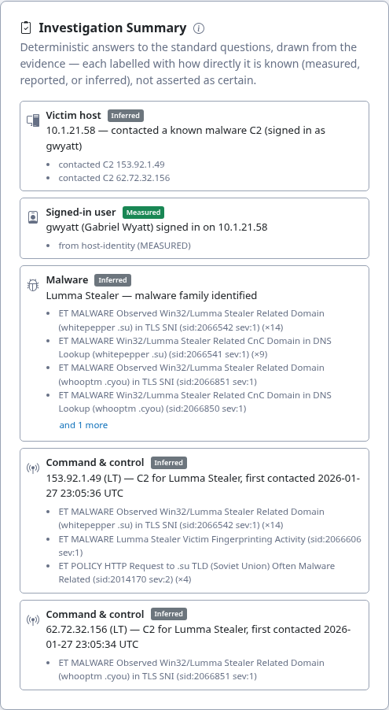
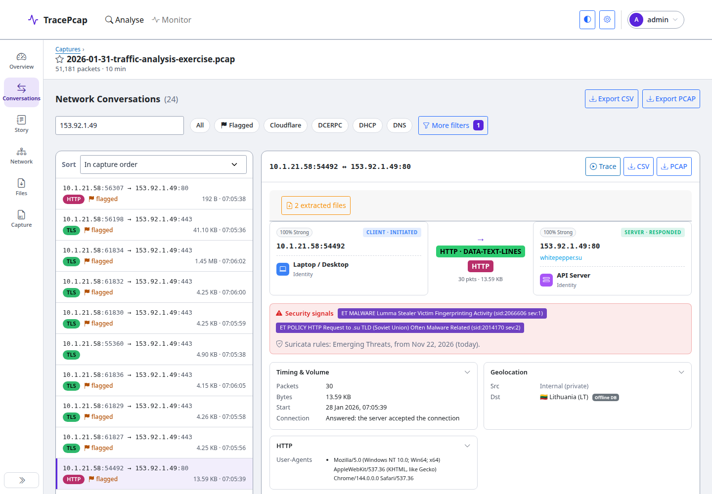

Lumma Stealer — "Lumma in the Room-ah!"
=========================================

.. note::

   **Captured against TracePcap** ``v0.5.0`` **(dev, 22 November 2026)**, including the conversation
   grouping fix (#1257) and per-direction byte counts (#1260). TracePcap changes quickly, so this
   walkthrough is a point-in-time record: the deterministic conclusions are stable, but screenshots,
   counts and UI details reflect that build. Re-verify against the current build before quoting a
   figure.

A credential-stealing infection, worked from the traffic alone and checked against the exercise's
published answer key. Unlike a remote-access trojan, an info-stealer does its damage quickly over
HTTPS and leaves: there is no long-lived beacon to find, so the evidence is a burst of TLS sessions
and one fingerprinting request.

The exercise
------------

`malware-traffic-analysis.net <https://www.malware-traffic-analysis.net/>`_'s
`2026-01-31 exercise <https://www.malware-traffic-analysis.net/2026/01/31/index.html>`_. A SOC analyst
sees an alert, **ET MALWARE Lumma Stealer Victim Fingerprinting Activity**, on traffic from
``153.92.1.49`` over TCP port 80, retrieves a capture from the internal host that triggered it, and
writes up the incident.

What you are given
------------------

.. list-table::
   :header-rows: 1
   :widths: 32 68

   * - Given
     - Value
   * - LAN segment
     - ``10.1.21.0/24`` (gateway ``10.1.21.1``)
   * - Active Directory domain
     - ``win11office.com`` (``WIN11OFFICE``)
   * - Domain controller
     - ``10.1.21.2`` (``WIN-LU4L24X3UB7``)
   * - The task
     - The infected client's IP, MAC address, host name, user account and the user's **full name**,
       and the domain from ``153.92.1.49`` that triggered the Lumma alert.

The capture isn't committed to this repository (third-party incident archives can carry live
malware). Get it from the exercise page; malware-traffic-analysis.net's ZIPs use the password scheme
``infected_YYYYMMDD`` (here ``infected_20260131``).

Walking it through TracePcap
----------------------------

Step 1 — Upload and analyse
~~~~~~~~~~~~~~~~~~~~~~~~~~~

Upload the ``.pcap`` on the home page with **Intrusion alerts (Suricata)** ticked under *Analyse
with*. It is off by default because it adds time; this exercise's answers come from its alerts. One
upload runs the whole pipeline: dissection, nDPI, Suricata, the Windows identity pass and the
knowledge layer.

Step 2 — The Investigation Summary answers the report
~~~~~~~~~~~~~~~~~~~~~~~~~~~~~~~~~~~~~~~~~~~~~~~~~~~~~~

   The Investigation Summary on the Overview tab. Repeated alerts are collapsed with a count
   (``×14``); longer evidence folds behind *and N more*.

.. list-table::
   :header-rows: 1
   :widths: 20 50 14 16

   * - Question
     - Answer
     - Grade
     - From
   * - Signed-in user
     - ``gwyatt`` (**Gabriel Wyatt**) on ``10.1.21.58``
     - MEASURED
     - Kerberos sign-in; full name from the domain controller
   * - Victim host
     - ``10.1.21.58``, which contacted the C2s below
     - INFERRED
     - contacted a known C2
   * - Malware
     - **Lumma Stealer**
     - INFERRED
     - ET rules' ``malware_family`` tag
   * - Command & control
     - ``153.92.1.49`` (LT), first contacted 2026-01-27 23:05:36 UTC; and ``62.72.32.156`` (LT),
       23:05:34 UTC
     - INFERRED
     - IDS + first contact

**The full name** isn't in a Kerberos or LDAP field in this capture. It comes from an SMB call
Windows makes at sign-in: the domain controller's *QueryUserInfo* reply names the account's full
name (``gwyatt`` → *Gabriel Wyatt*). TracePcap ties it to the host's signed-in account (see
:doc:`/features/windows-identity`). The answer key finds the same value by searching packet details
for the string "Wyatt".

**The family** comes from the rules' own metadata. ET tags these rules
``malware_family Lumma_Stealer``; TracePcap reads that tag rather than guessing a name from the rule's
message, which in this case ("Win32/Lumma Stealer …") an earlier version couldn't parse at all.

Step 3 — The C2 conversation
~~~~~~~~~~~~~~~~~~~~~~~~~~~~

Filtering **Conversations** to ``153.92.1.49`` lists every session with the C2: mostly TLS, with two
plain-HTTP requests on port 80. The 13.6 KB one is the alert the analyst started from.

   ``10.1.21.58 → 153.92.1.49:80``, server name ``whitepepper.su``, flagged **ET MALWARE Lumma Stealer
   Victim Fingerprinting Activity** (sid 2066606), with the browser user agent the request claimed.
   Times on screen are in the server's zone (UTC+8 here); the answers and the key use UTC.

The server column names the domain the key asks for, ``whitepepper.su``, from the TLS SNI and HTTP
Host of these sessions.

Checked against the answer key
------------------------------

.. list-table::
   :header-rows: 1
   :widths: 26 32 32 10

   * - Question
     - Answer key
     - TracePcap
     - Match
   * - Infected client IP
     - ``10.1.28[.]58`` (see below)
     - ``10.1.21.58``
     - ✓
   * - MAC address
     - ``00:21:5d:c8:0e:f2``
     - ``00:21:5d:c8:0e:f2`` (host page)
     - ✓
   * - Host name
     - ``DESKTOP-ES9F3ML``
     - ``DESKTOP-ES9F3ML`` (NBNS, host page)
     - ✓
   * - User account
     - ``gwyatt``
     - ``gwyatt``
     - ✓
   * - User's full name
     - Gabriel Wyatt
     - Gabriel Wyatt
     - ✓
   * - Domain behind the alert
     - ``whitepepper[.]su``
     - ``whitepepper.su`` (the C2 conversation's server)
     - ✓

.. tip::

   **A typo in the key.** Its victim details say ``10.1.28[.]58``, but its own LAN range
   (``10.1.21.0/24``), its hints and every screenshot say ``10.1.21.58``, and so does the capture.

**Beyond the key.** TracePcap names a second C2, ``62.72.32.156`` (``whooptm.cyou``). The victim
opened TLS to it two seconds before the key's ``whitepepper.su`` traffic, it answered, and ET's rule
2066851 calls ``whooptm.cyou`` a Lumma Stealer domain. Lumma carries a list of C2 domains and works
through them; the key's question only asked about ``153.92.1.49``. The evaluation harness records it
as a finding *beyond the key*, with that evidence, rather than as a wrong answer
(``eval/cases/2026-01-31-lumma``).

The key also mentions follow-up HTTPS to ``holiday-forever.cc`` and
``communicationfirewall-security.cc``. TracePcap shows those sessions (search *.cc* in Conversations)
but draws no conclusion about them: no rule fired.

What this demonstrates
----------------------

Every question in the report is answered from one upload, including the person's full name, which
the key recovers by a manual string search. The family comes from the IDS rule's own metadata, not a
guess, and an extra C2 the key didn't ask about is reported with its evidence rather than hidden.
