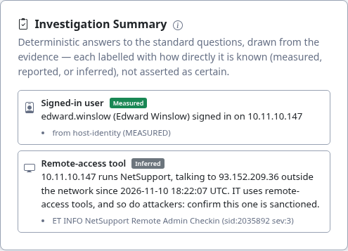

NetSupport RAT — "The Lucky Turkey"
====================================

.. note::

   **Captured against TracePcap** ``v0.5.0`` **(dev, 22 November 2026)**, including the conversation
   grouping fix (#1257) and per-direction byte counts (#1260). TracePcap changes quickly, so this
   walkthrough is a point-in-time record: the deterministic conclusions are stable, but screenshots,
   counts and UI details reflect that build. Re-verify against the current build before quoting a
   figure.

A remote-access trojan that is really a commercial remote-admin product. NetSupport Manager is sold
to IT departments, which is exactly why criminals use it: its traffic looks like administration. This
page shows what TracePcap says about it, where it stops short of calling it malware, and why.

The exercise
------------

`malware-traffic-analysis.net <https://www.malware-traffic-analysis.net/>`_'s
`2026-11-10 exercise <https://www.malware-traffic-analysis.net/2026/11/10/index.html>`_. Alerts for
NetSupport RAT on ``93.152.209.36:443``; the analyst retrieves the host's capture to verify them.

What you are given
------------------

.. list-table::
   :header-rows: 1
   :widths: 32 68

   * - Given
     - Value
   * - LAN segment
     - ``10.11.10.0/24`` (gateway ``10.11.10.1``)
   * - Active Directory domain
     - ``theluckyturkey.com`` (``THELUCKYTURKEY``)
   * - Domain controller
     - ``10.11.10.10`` (``LUCKYTURKEY-DC``)
   * - The task
     - The **date and start time** of the NetSupport RAT traffic, and the infected client's IP, MAC,
       host name and user account.

The capture isn't committed to this repository; get it from the exercise page (ZIP password
``infected_20261110``, following the site's scheme).

Walking it through TracePcap
----------------------------

Step 1 — Upload and analyse
~~~~~~~~~~~~~~~~~~~~~~~~~~~

Upload with **Intrusion alerts (Suricata)** ticked.

Step 2 — The Investigation Summary
~~~~~~~~~~~~~~~~~~~~~~~~~~~~~~~~~~

   The summary names the user and flags NetSupport talking to an outside server, with when it began.
   It does not name a victim, a malware family or a C2.

.. list-table::
   :header-rows: 1
   :widths: 20 52 12 16

   * - Question
     - Answer
     - Grade
     - From
   * - Signed-in user
     - ``edward.winslow`` (Edward Winslow) on ``10.11.10.147``
     - MEASURED
     - Kerberos sign-in
   * - Remote-access tool
     - ``10.11.10.147`` runs **NetSupport**, talking to ``93.152.209.36`` outside the network since
       **2026-11-10 18:22:07 UTC**; *confirm it's sanctioned*
     - INFERRED
     - IDS (*ET INFO NetSupport Remote Admin Checkin*) + first contact

The start time is the exercise's first question, and it matches the key to the second.

Step 3 — The session
~~~~~~~~~~~~~~~~~~~~

.. figure:: images/mta-netsupport-conversation.png
   :alt: The NetSupport session to 93.152.209.36
   :width: 100%

   Filtering Conversations to ``93.152.209.36``: **one** conversation, 256 packets from the opening
   SYN to the end, flagged *ET INFO NetSupport Remote Admin Checkin* and *ET POLICY HTTP traffic on
   port 443 (POST)*. Times on screen are in the server's zone (UTC+8 here): 02:22:07 on 11 November
   is 18:22:07 UTC on the 10th.

Checked against the answer key
------------------------------

.. list-table::
   :header-rows: 1
   :widths: 30 30 30 10

   * - Question
     - Answer key
     - TracePcap
     - Match
   * - Start of the NetSupport traffic
     - 2026-11-10 18:22:07 UTC
     - 2026-11-10 18:22:07 UTC
     - ✓
   * - IP address
     - ``10.11.10.147``
     - ``10.11.10.147`` (the host running NetSupport)
     - ✓
   * - MAC address
     - ``00:12:f0:e5:17:43``
     - ``00:12:f0:e5:17:43``
     - ✓
   * - Host name
     - ``DESKTOP-5OMVI3L``
     - ``DESKTOP-5OMVI3L``
     - ✓
   * - User account
     - ``edward.winslow``
     - ``edward.winslow``
     - ✓

The analyst gets every answer, but TracePcap's *own* conclusions stop at "a remote-access tool to
confirm". It doesn't declare ``10.11.10.147`` a victim, NetSupport malware, or ``93.152.209.36`` a C2.

Why it stops there
------------------

The only alert is ET's **INFO** rule for NetSupport's check-in. ET files it under INFO, not MALWARE,
because NetSupport Manager is a legitimate product many IT teams run. TracePcap follows the same
line: a remote-admin tool is surfaced for review, never called malware on that alone.

The capture holds the story that makes this one malicious, spread across several weak signals:

- the host fetched a page from ``vericheckusgo.com`` and then ``/5555.mp4`` from ``96.62.224.200``;
- PowerShell downloaded a packed executable (*ET INFO Windows Powershell User-Agent Usage*,
  *ET INFO Packed Executable Download*);
- minutes later NetSupport began checking in to a **bare IP address**, not a vendor domain, using
  plain HTTP on port 443.

A legitimate NetSupport install rarely looks like that chain. Escalating it (a remote-access check-in
to a bare IP, preceded on the same host by a PowerShell download) to a probable unsanctioned install
is a candidate improvement. It would be graded INFERRED with every link as evidence, and the
evaluation harness would show whether it raises false alarms.

.. tip::

   **A download is not an upload.** Earlier builds reported this host as having *sent* 6.3 MB to
   ``96.62.224.200`` and flagged it for possible exfiltration. It was the reverse: that server sent
   the host the 6 MB ``5555.mp4``. TracePcap now counts the bytes each side sends, and the
   bulk-transfer check only considers what the host sent.

What this demonstrates
----------------------

Every answer the exercise asks for, including the exact start time, with the line between "seen" and
"concluded" drawn where an analyst would draw it. The tool shows the remote-access session and when
it began; deciding that a commercial admin tool is a RAT here is left to evidence TracePcap doesn't
yet chain together, and says so.
