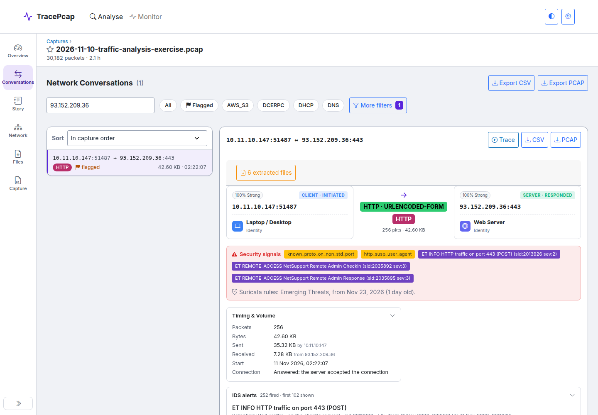

NetSupport RAT — "The Lucky Turkey"
====================================

.. note::

   **Captured against TracePcap** ``v0.5.0-70`` **(dev, 25 November 2026)**. TracePcap changes quickly, so this
   walkthrough is a point-in-time record: the deterministic conclusions are stable, but screenshots,
   counts and UI details reflect that build. Re-verify against the current build before quoting a
   figure.

A remote-access trojan that is really a commercial remote-admin product. NetSupport Manager is sold
to IT departments, which is exactly why criminals use it: its traffic looks like administration. No
rule calls this traffic malware. This page shows how TracePcap gets there anyway, from how the tool
was installed, and what it still leaves to the analyst.

The exercise
------------

`malware-traffic-analysis.net <https://www.malware-traffic-analysis.net/>`_'s
`2026-11-10 exercise <https://www.malware-traffic-analysis.net/2026/11/10/index.html>`_. Alerts for
NetSupport RAT on ``93.152.209.36:443``; the analyst retrieves the host's capture to verify them.

What you are given
------------------

.. list-table::
   :header-rows: 1
   :widths: 32 68

   * - Given
     - Value
   * - LAN segment
     - ``10.11.10.0/24`` (gateway ``10.11.10.1``)
   * - Active Directory domain
     - ``theluckyturkey.com`` (``THELUCKYTURKEY``)
   * - Domain controller
     - ``10.11.10.10`` (``LUCKYTURKEY-DC``)
   * - The task
     - The **date and start time** of the NetSupport RAT traffic, and the infected client's IP, MAC,
       host name and user account.

The capture isn't committed to this repository; get it from the exercise page (ZIP password
``infected_20261110``, following the site's scheme).

Walking it through TracePcap
----------------------------

Step 1 — Upload and analyse
~~~~~~~~~~~~~~~~~~~~~~~~~~~

Upload with **Intrusion alerts (Suricata)** ticked.

Step 2 — The Investigation Summary
~~~~~~~~~~~~~~~~~~~~~~~~~~~~~~~~~~

.. figure:: images/mta-netsupport-summary.png
   :alt: Investigation Summary: victim, user, NetSupport RAT and its C2, and the remote-access session
   :width: 60%

   The summary names the victim, the user, NetSupport RAT and its C2. The NetSupport session is
   also listed as a remote-access tool, pointing back to the C2 answer.

.. list-table::
   :header-rows: 1
   :widths: 20 52 12 16

   * - Question
     - Answer
     - Grade
     - From
   * - Signed-in user
     - ``edward.winslow`` (Edward Winslow) on ``10.11.10.147``
     - MEASURED
     - Kerberos sign-in; full name from the domain controller
   * - Victim host
     - ``10.11.10.147``, which talked to the C2
     - INFERRED
     - contacted the C2 below
   * - Malware
     - **NetSupport RAT** (*probable unsanctioned install*)
     - INFERRED
     - the install chain (below)
   * - Command & control
     - ``93.152.209.36`` (CN), first contacted **2026-11-10 18:22:07 UTC**
     - INFERRED
     - the install chain + IDS (*ET REMOTE_ACCESS NetSupport Remote Admin Checkin*)
   * - Remote-access tool
     - ``10.11.10.147`` runs **NetSupport**, talking to ``93.152.209.36`` since 18:22:07 UTC;
       *the command & control answer treats this server as a C2 for NetSupport RAT from how the
       tool was installed, so this probably isn't a sanctioned install*
     - INFERRED
     - IDS + first contact

The start time is the exercise's first question, and it matches the key to the second.

**How it got to "RAT".** The only rules that fired are ET's *REMOTE_ACCESS* rules for NetSupport's
check-in and response. ET doesn't file them under MALWARE, because NetSupport Manager is a
legitimate product many IT teams run, and TracePcap never calls a remote-admin tool malware on its
alerts alone. What makes this one a RAT is how it arrived, and the capture holds all of it:

- at 18:21:49 UTC a **script engine** (PowerShell's user agent) on ``10.11.10.147`` fetched from
  ``vericheckusgo.com`` (``96.62.224.200``);
- at 18:21:58 that server sent the host **6.3 MB** (``/5555.mp4``), in about two seconds;
- at 18:22:07, **8 seconds after that download began**, NetSupport began checking in to a **bare
  IP address**, ``93.152.209.36``, not a vendor domain, over plain HTTP on port 443, every 60
  seconds for the next two hours.

That chain is a rule TracePcap applies: *a RAT checking in to a bare IP minutes after a script engine
on the same host fetched a large payload from another server is how it was planted.* The **How we
got here** button on the C2 answer shows it as the first step, with the rule in words. It's graded
INFERRED, and the C2 answer says *probable unsanctioned install*. (The capture's *ET INFO Packed
Executable Download* alert is a Windows Update at 18:30, not part of the chain.)

**Two answers about one session.** The remote-access check fires on any remote-admin tool talking
to a server outside the network, and on its own it asks the analyst to confirm the tool is
sanctioned (as it does for TeamViewer in :doc:`fake-software-site`). Here the C2 answer has already
made the server a C2 from the install chain, so the remote-access answer points to it, no more
firmly than that answer puts it: *probably* not a sanctioned install. Its **How we got here** cites
the C2 conclusion as a step. *(From a later build than the rest of this page: earlier, it asked
anyway, beside the C2 answer.)*

Step 3 — The session
~~~~~~~~~~~~~~~~~~~~

   Filtering Conversations to ``93.152.209.36``: **one** conversation, 256 packets from the opening
   SYN to the end, flagged *ET REMOTE_ACCESS NetSupport Remote Admin Checkin* and *Response*, and
   *ET INFO HTTP traffic on port 443 (POST)*. Its IDS alerts read *252 fired · first 102 shown*:
   alert records stop at 100 in each direction of a connection, so these are the first 100 on the
   host's check-ins and the 2 on the server's replies. Times on screen are in the server's zone
   (UTC+8 here): 02:22:07 on 11 November is 18:22:07 UTC on the 10th.

Checked against the answer key
------------------------------

.. list-table::
   :header-rows: 1
   :widths: 30 30 30 10

   * - Question
     - Answer key
     - TracePcap
     - Match
   * - Start of the NetSupport traffic
     - 2026-11-10 18:22:07 UTC
     - 2026-11-10 18:22:07 UTC
     - ✓
   * - IP address
     - ``10.11.10.147``
     - ``10.11.10.147`` (the host running NetSupport)
     - ✓
   * - MAC address
     - ``00:12:f0:e5:17:43``
     - ``00:12:f0:e5:17:43``
     - ✓
   * - Host name
     - ``DESKTOP-5OMVI3L``
     - ``DESKTOP-5OMVI3L``
     - ✓
   * - User account
     - ``edward.winslow``
     - ``edward.winslow``
     - ✓

TracePcap matches every answer in the key, and its own conclusions agree with it: the key's
NetSupport RAT on ``93.152.209.36`` is the C2 answer, reached without a malware rule.

.. tip::

   **A download is not an upload.** Earlier builds reported this host as having *sent* 6.3 MB to
   ``96.62.224.200`` and flagged it for possible exfiltration. It was the reverse: that server sent
   the host the 6 MB ``5555.mp4``. TracePcap now counts the bytes each side sends, and the
   bulk-transfer check only considers what the host sent.

What this demonstrates
----------------------

Every answer the exercise asks for, including the exact start time, and a RAT recognised without a
rule that calls it malware. TracePcap chains the evidence an analyst would (a script fetch, a large
payload, then a commercial admin tool checking in to a bare IP seconds later), names the rule it
applied, and grades the result INFERRED rather than certain.
