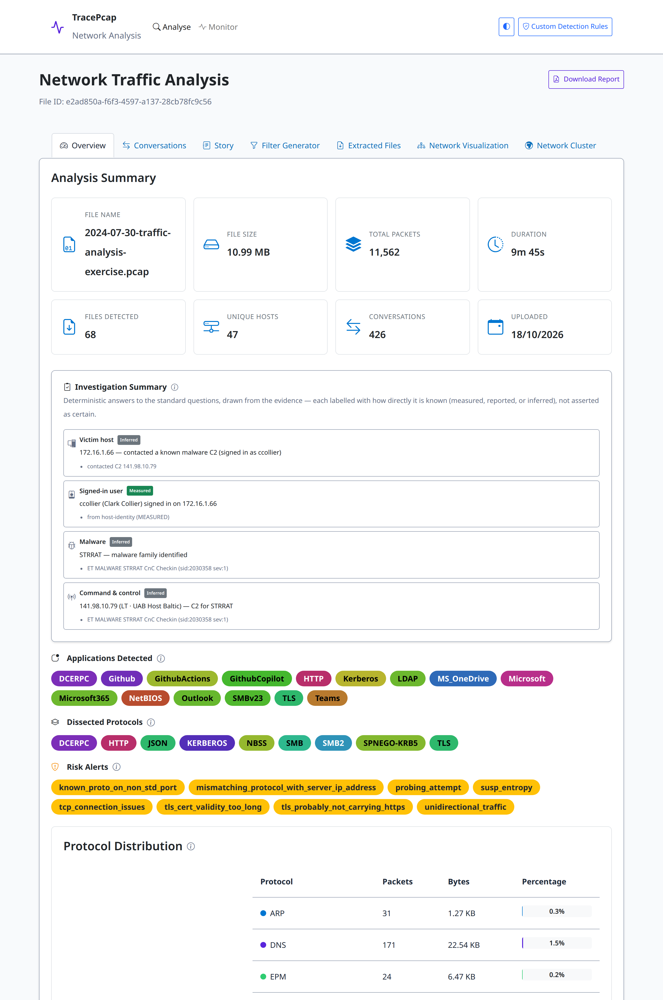
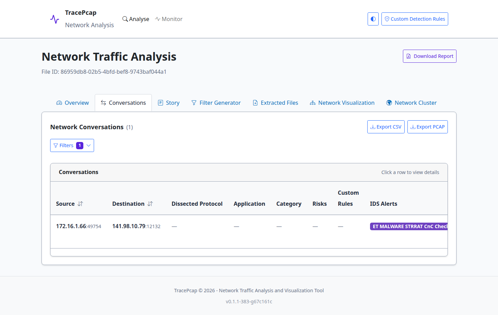
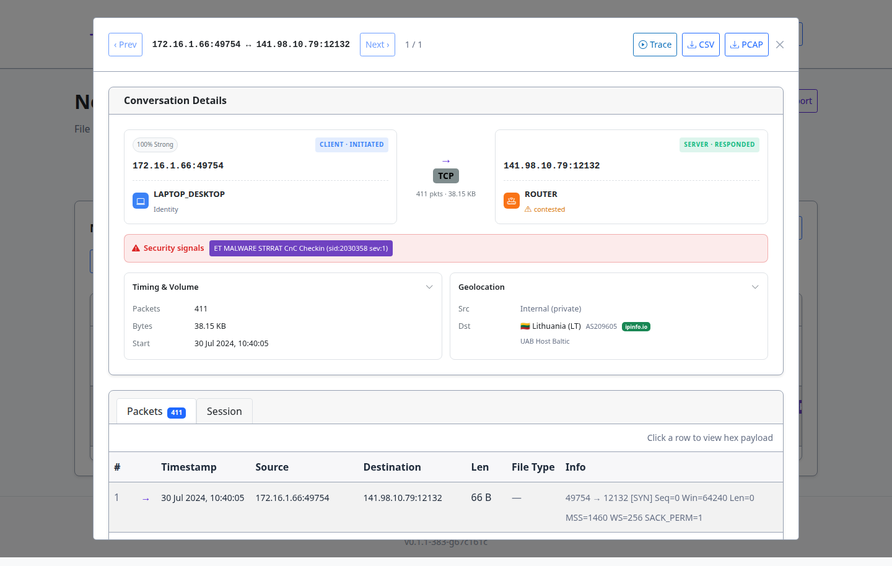
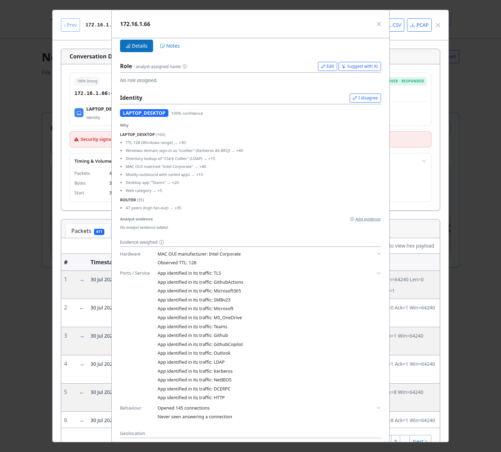

STRRAT infection — "You dirty rat!"
====================================

This walkthrough runs a real, publicly available network-forensics incident through TracePcap's
*existing* features, end to end. It works the way an analyst would: from the captured traffic alone,
with no prior knowledge of the network, and cross-checks every result against the exercise's own
official answer key.

.. note::

   Nearly everything here comes from TracePcap's **deterministic** layers — Suricata, nDPI, the host
   classifier, the Kerberos/LDAP identity extractor, and the knowledge layer that folds them into one
   graded **investigation**. The LLM "Story mode" narrative comes last, *grounded in* those findings
   rather than being their source. That distinction is the point of the demo: the ground truth is
   deterministic, graded, and reproducible.

The exercise
------------

`malware-traffic-analysis.net <https://www.malware-traffic-analysis.net/>`_ publishes real malware
traffic as training exercises: a packet capture from a realistic, simulated corporate infection, a
short scenario prompt, and an answer key. Analysts download the capture and practice incident response
from network data alone.

The scenario here is the `2024-07-30 "You dirty rat!" exercise
<https://www.malware-traffic-analysis.net/2024/07/30/index.html>`_. The title is a pun — the malware is
a **RAT** (Remote Access Trojan), specifically **STRRAT**, a Java-based commodity RAT that provides
remote control, keylogging, and credential theft. It was delivered as an **email attachment**, so the
loader itself is out of band; the capture contains only the **post-infection network traffic** — which
is exactly the black-box situation TracePcap is built for.

What you are given
------------------

The exercise hands the analyst the environment and the task, and nothing else — everything else has to
be recovered from the capture.

**Scenario briefing (the simulated corporate LAN):**

.. list-table::
   :header-rows: 1
   :widths: 32 68

   * - Given
     - Value
   * - LAN subnet
     - ``172.16.1.0/24``
   * - Active Directory domain
     - ``wiresharkworkshop.online``
   * - Domain controller
     - ``172.16.1.4`` (``WIRESHARK-WS-DC``)
   * - The task
     - Identify the infected host and its details (IP, MAC, hostname, the logged-in user), the malware
       family, and the command-and-control server — i.e. write the incident report.

**The capture itself is not committed to this repository.** Third-party incident archives can carry
live malware samples, so they stay out of git by policy. Download it from the source instead:

- Page: https://www.malware-traffic-analysis.net/2024/07/30/index.html
- The capture ZIP is password-protected. malware-traffic-analysis.net uses a fixed scheme,
  ``infected_YYYYMMDD`` where the date is the post date — so this one is ``infected_20240730``.

Everything below is what TracePcap recovers, starting from just that briefing and the ``.pcap``.

Walking it through TracePcap
----------------------------

Step 1 — Upload and analyse
~~~~~~~~~~~~~~~~~~~~~~~~~~~~~

Upload the ``.pcap`` through the normal :doc:`upload flow </features/pcap-upload>`. A single
deterministic pipeline runs on ingest — packet dissection, nDPI application identification, Suricata
(Emerging Threats ruleset), host classification, and the Kerberos/LDAP identity extraction — and a
knowledge layer assembles the results into a graded :doc:`investigation </architecture/knowledge-layer>`.
No LLM is involved in any of it. When analysis completes, every view below is populated.

Step 2 — Overview: the shape of the capture
~~~~~~~~~~~~~~~~~~~~~~~~~~~~~~~~~~~~~~~~~~~~~

The **Overview** tab is the landing summary: 11,562 packets across 47 hosts and 426 conversations, the
protocol mix, the applications nDPI identified, and a row of risk-alert badges. Two protocols worth
noting immediately are **KRB5** (Kerberos) and **LDAP** — the directory-service traffic that will name
the victim.

   The Overview tab: inventory, protocol distribution (note KRB5 and LDAP), detected applications, and
   nDPI risk alerts.

Step 3 — The investigation summary: the incident report, answered
~~~~~~~~~~~~~~~~~~~~~~~~~~~~~~~~~~~~~~~~~~~~~~~~~~~~~~~~~~~~~~~~~~~~~

Before touching a single packet, the **Investigation Summary** (on the Overview and Story tabs) already
answers the exercise's questions. It is produced by deterministic checks that read the assembled
knowledge board — not the LLM — and each answer carries a **grade** recording how directly it is known:
``MEASURED`` (the traffic itself exhibited it), ``REPORTED`` (a party asserted it on the wire), or
``INFERRED`` (a tool or heuristic judged it).

.. list-table::
   :header-rows: 1
   :widths: 20 50 14 16

   * - Goal
     - Answer
     - Grade
     - From
   * - Signed-in user
     - ``ccollier`` signed in on ``172.16.1.66``
     - MEASURED
     - Kerberos AS-REQ
   * - Victim host
     - ``172.16.1.66`` — contacted a known malware C2 (signed in as ``ccollier``)
     - INFERRED
     - contacted the C2 below
   * - Malware
     - ``STRRAT``
     - INFERRED
     - IDS + stream fingerprint
   * - Command & control
     - ``141.98.10.79`` (LT · UAB Host Baltic) — C2 for STRRAT
     - INFERRED
     - IDS + beacon + GeoIP

The summary names *who, what, and where* at a glance, and it is honest about certainty: the signed-in
user is ``MEASURED`` (the host authenticated as that principal), while the malware and C2 are
``INFERRED`` (a signature and a protocol fingerprint judged them). The rest of this walkthrough is the
evidence beneath each of those answers.

.. admonition:: It does not depend on the IDS being present
   :class: tip

   Re-run the same capture with Suricata switched **off** and the investigation still names STRRAT and
   the C2. The host's sustained, low-throughput, raw-TCP session to ``141.98.10.79:12132`` is flagged
   as a **beacon** from its traffic shape alone, and following that stream recovers STRRAT's cleartext
   check-in (``ping|STRRAT|…|ccollier|…``). A conclusion in TracePcap is not held up by any single
   library being installed.

Step 4 — Threat detection: the C2 conversation
~~~~~~~~~~~~~~~~~~~~~~~~~~~~~~~~~~~~~~~~~~~~~~~~

TracePcap runs Suricata automatically, so the family is named without any manual pcap digging. In the
**Conversations** tab, filtering to the destination ``141.98.10.79`` leaves a single flow — and its IDS
Alerts column already carries the verdict:

   One conversation, ``172.16.1.66:49754 → 141.98.10.79:12132``, flagged **"ET MALWARE STRRAT CnC
   Checkin"** (sid 2030358).

That single signature anchors the malware family (**STRRAT**), the **C2 endpoint**
(``141.98.10.79:12132``), and the infected host (``172.16.1.66``) — and it is the evidence behind the
``INFERRED`` malware and C2 answers in the summary above.

Step 5 — Conversation detail: the full picture of the C2 channel
~~~~~~~~~~~~~~~~~~~~~~~~~~~~~~~~~~~~~~~~~~~~~~~~~~~~~~~~~~~~~~~~~~~~

Opening that conversation shows both endpoints in context: the client ``172.16.1.66`` classified as a
laptop/desktop, the server as an external host, the Suricata security signal restated, and — via the
offline GeoIP database — the C2's location.

   The C2 channel in full: the STRRAT security signal, GeoIP placing ``141.98.10.79`` in Lithuania
   (UAB Host Baltic), and the raw packet list.

Step 6 — Host identity: recovering the person at the keyboard
~~~~~~~~~~~~~~~~~~~~~~~~~~~~~~~~~~~~~~~~~~~~~~~~~~~~~~~~~~~~~~~~

Clicking the victim host opens its identity panel — the capability this demo motivated (see
:doc:`/features/windows-identity`). The exercise's own answer key recovers the user's identity by
hand, filtering LDAP for a ``givenName`` attribute. TracePcap does it automatically: it reads the
client's own **Kerberos AS-REQ** (``ccollier`` authenticating) and the **LDAP directory lookup** of
that account (``CN=Clark Collier,CN=Users,DC=…``), and folds both into the host's classification
evidence.

   ``172.16.1.66`` → LAPTOP_DESKTOP, with the *Why* breakdown naming the user: **Windows domain
   sign-in as "ccollier" (Kerberos AS-REQ) → +40** and **Directory lookup of "Clark Collier" (LDAP)
   → +15**.

The Kerberos claim is the stronger of the two — the client authenticated *as* that principal — so the
signed-in-user answer is graded ``MEASURED`` and weighs more than the LDAP directory lookup, which
merely names an account someone queried. The domain controller (``172.16.1.4``) is deliberately
**not** credited with a signed-in user, and machine accounts (``DESKTOP-SKBR25F$``) are excluded, so no
computer object is ever mistaken for a person.

Step 7 — Behaviour: the beacon, the top-talker, and an honest gap
~~~~~~~~~~~~~~~~~~~~~~~~~~~~~~~~~~~~~~~~~~~~~~~~~~~~~~~~~~~~~~~~~~~~

Behavioural analysis adds shape to the picture, independent of any signature:

- **The C2 beacon, by shape alone.** The host's session to ``141.98.10.79:12132`` is flagged as a
  suspected beacon purely from its traffic shape — a sustained, low-throughput, raw-TCP channel to an
  external host on a non-standard port, carried over hundreds of packets. This is the same endpoint the
  Suricata rule named, reached independently; it is what lets the investigation stand up with the IDS
  off.
- **Not the domain controller.** The host also exchanges perfectly regular NetBIOS keepalives with the
  DC (``172.16.1.4:139``) — periodic to the millisecond. TracePcap deliberately does **not** call that
  a beacon: regular traffic to an internal service port is ordinary Windows behaviour, not
  command-and-control. (Flagging it was a real false positive; see issue #823.)
- **Top-talker and fan-out.** ``172.16.1.66`` initiated 368 flows to 46 distinct destinations and
  produced **97.1%** of all bytes in the capture.
- **An honest visibility gap.** 66.9% of conversations (285 of 426) could not be classified by nDPI —
  surfaced as a HIGH finding rather than pretending to full coverage.

Step 8 — Story mode: a grounded narrative
~~~~~~~~~~~~~~~~~~~~~~~~~~~~~~~~~~~~~~~~~~~

With a local LLM configured (see :doc:`/configuration/llm-setup`), **Story mode** writes a SOC-style
narrative. It is built *on* the investigation above: the graded answers are handed to the model as
ground truth it must name and must not contradict, and the prose cites the evidence beneath each one
(the Suricata signature, the Kerberos sign-in, the beacon's cleartext check-in). The model narrates and
answers follow-up questions; it does not detect.

.. important::

   Story mode is the one layer that needs the LLM, and it is deliberately last. Everything above —
   the investigation summary, the signature hit, the recovered identity, the beacon — is produced by
   the deterministic pipeline and stands on its own, offline and reproducible. The narrative's job is
   to make those findings readable, and each claim it makes is tagged with the grade of the finding it
   rests on, so an ``INFERRED`` attribution is never dressed up as certainty.

Artifacts recovered
-------------------

From one upload, with no prior knowledge of the network, TracePcap surfaced:

.. list-table::
   :header-rows: 1
   :widths: 20 44 36

   * - Question
     - Answer
     - How TracePcap found it
   * - Who?
     - ``ccollier`` (Clark Collier)
     - Kerberos AS-REQ + LDAP directory lookup (host identity)
   * - What?
     - STRRAT (Java RAT)
     - Suricata "ET MALWARE STRRAT CnC Checkin"; corroborated by the beacon's cleartext check-in
   * - Where (C2)?
     - ``141.98.10.79:12132`` (Lithuania)
     - Suricata signature + beaconing shape + offline GeoIP
   * - Which host?
     - ``172.16.1.66`` — Windows laptop/desktop, ``DESKTOP-SKBR25F``, Intel NIC
     - Host classification (TTL, OUI, apps, sign-in)
   * - How does it behave?
     - A beacon to the C2 on ``:12132``; 97.1%-of-bytes top-talker
     - Behavioural / beacon analysis

.. tip::

   A small cross-check worth noting: the exercise's published answer key lists the C2 as
   ``141.98.10.69``, while the destination in the capture — and the address the ET STRRAT rule matches —
   is ``141.98.10.79``. A one-digit transcription difference; TracePcap reports what is on the wire.

What this demonstrates
----------------------

The most forensically valuable answers — *who, what, where, and how it behaves* — came from
deterministic analysis, reproducibly and offline, from a single upload, and the investigation summary
presents them already graded by how directly each is known. The Kerberos/LDAP identity extraction
closes the one gap the exercise's answer key had to fill by hand. The beaconing and stream analysis
mean the C2 and the malware family are recovered even with the IDS turned off. And the LLM narrative,
useful as a readable summary, is exactly that: a layer on top whose every claim is anchored to — and
graded by — the deterministic evidence beneath it.
