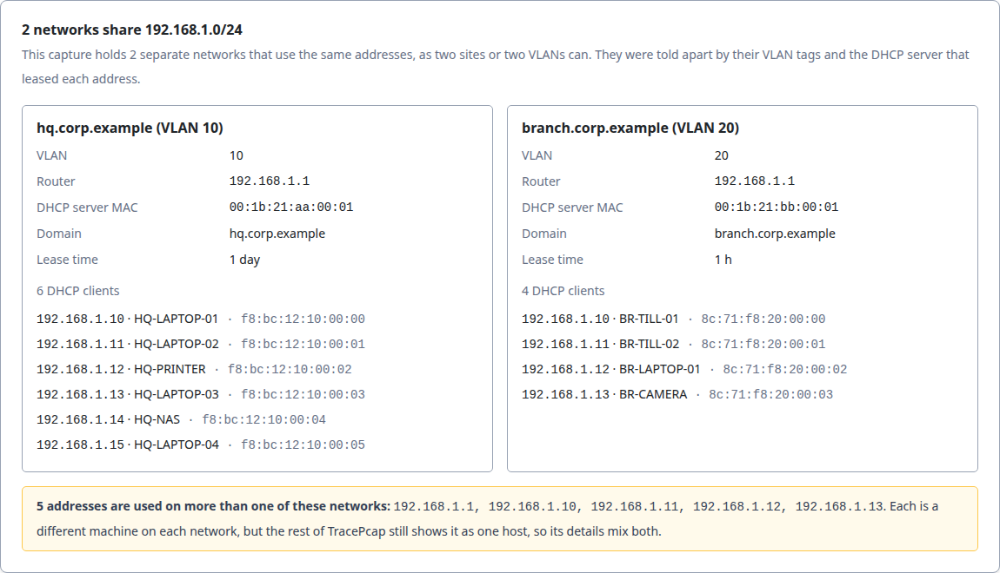
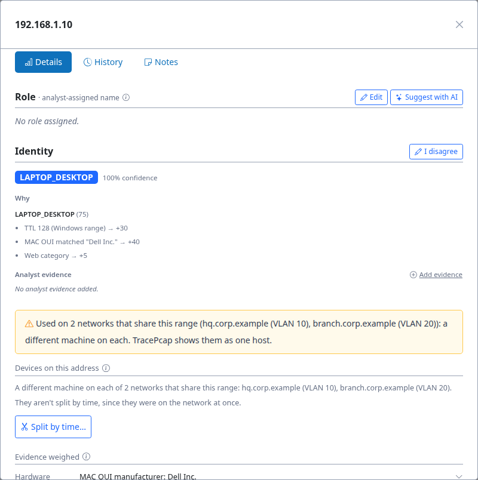

Two sites, one range: telling networks apart
============================================

.. note::

   **Captured against TracePcap** ``v0.2.0-338`` **(dev, 14 November 2026).** TracePcap changes
   quickly, so this walkthrough is a point-in-time record. Which network each address belongs to,
   and the evidence for it, are stable across versions; screenshots and UI details reflect *that*
   build, and a later one may differ. Re-verify against the current build before quoting a figure.

Private address ranges get reused. Two offices can both run ``192.168.1.0/24`` with a router at
``192.168.1.1``, and two VLANs can share a range behind different gateways. A capture from a trunk
port, or two sites' captures merged for one investigation, then holds both networks at once.
``192.168.1.10`` at one site is a different machine from ``192.168.1.10`` at the other, but by
address alone they're one host.

This walkthrough asks: **given only the capture, can TracePcap tell how many networks there are,
and which machine belongs to which?**

The capture
-----------

``two_sites_overlap.pcap`` (from ``sample-files/gen_overlapping_sites.py``):

.. list-table::
   :header-rows: 1
   :widths: 20 40 40

   * -
     - HQ
     - Branch
   * - Range
     - ``192.168.1.0/24``
     - ``192.168.1.0/24``
   * - Router and DHCP server
     - ``192.168.1.1``, MAC ``00:1b:21:aa:00:01``
     - ``192.168.1.1``, MAC ``00:1b:21:bb:00:01``
   * - Domain (DHCP option 15)
     - ``hq.corp.example``
     - ``branch.corp.example``
   * - Lease time
     - 1 day
     - 1 hour
   * - VLAN
     - 10
     - 20
   * - DHCP clients
     - ``.10``–``.15`` (laptops, a printer, a NAS)
     - ``.10``–``.13`` (two tills, a laptop, a camera)

So ``.1`` and ``.10``–``.13`` are each used by two different machines.

``two_sites_overlap_untagged.pcap`` is the same traffic **without VLAN tags**, as when two sites'
captures are merged. It's the harder case: nothing on the wire says "site", so the networks have to
be told apart by what each DHCP server handed out.

What an address-keyed view gets wrong
-------------------------------------

Before TracePcap told networks apart, this capture came out as **one network**: ``192.168.1.13``
appeared with HQ's MAC but Branch's hostname ``BR-CAMERA``. ``192.168.1.10`` was read as one
address passing from an HQ laptop to a Branch till, though both held it all along. Nothing warned
that two networks were mixed.

What TracePcap shows
--------------------

Upload the capture. The **Overview** shows, under the capture summary:

         hq.corp.example (VLAN 10) and branch.corp.example (VLAN 20), with their router, DHCP
         server MAC, domain, lease time and DHCP clients, and a warning listing the 5 addresses used
         on both.

   Two networks on ``192.168.1.0/24``, each with what identifies it and the clients it leased to,
   and the five addresses used on both.

**How it told them apart.** Each DHCP lease records the network that handed it out: the VLAN tag on
the server's reply, the **server's MAC**, and the router, domain, lease time and mask it gave.
Leases are grouped per VLAN, or with no VLAN, per DHCP server MAC. Upload the **untagged** capture
and the result is the same two networks, told apart by their servers' MACs, domains and lease times
alone.

**On each shared address**, the host's details say so plainly:

         range, a different machine on each, and the device list saying the same.

   ``192.168.1.10``: a different machine on each network. It isn't split into devices over time,
   since both were on the network at once.

.. note::

   The **Identity** above the warning (Laptop / Desktop, Dell) is the HQ machine's. Outside the
   Overview panel and this warning, TracePcap still treats a shared address as one host: one
   classification, one node in the graph, one set of labels. Keeping the two apart everywhere is the
   next step (#462 phase 2).

Details: :doc:`../features/overlapping-networks`.

Reproducing it
--------------

.. code-block:: bash

   python3 sample-files/gen_overlapping_sites.py   # two_sites_overlap.pcap and the untagged one

Upload either capture and open its **Overview**.
