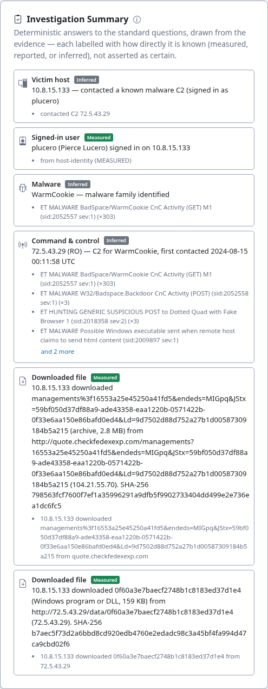
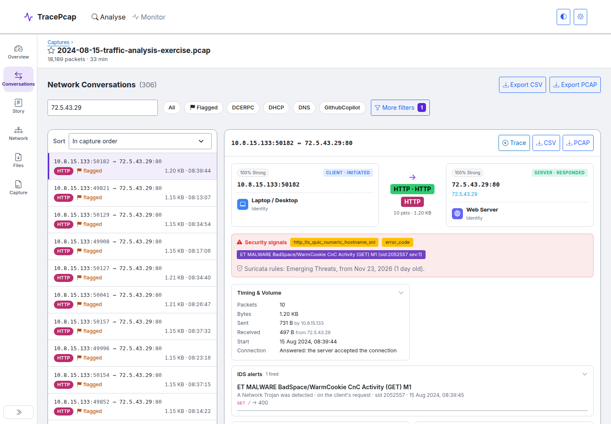
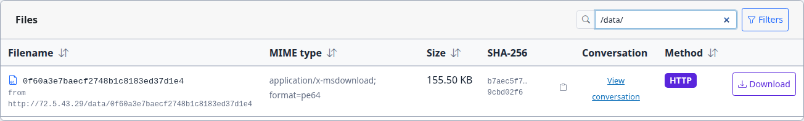

WarmCookie backdoor — a full incident report
============================================

.. note::

   **Captured against TracePcap** ``v0.5.0-70`` **(dev, 25 November 2026)**. TracePcap changes quickly, so this
   walkthrough is a point-in-time record: the deterministic conclusions are stable, but screenshots,
   counts and UI details reflect that build. Re-verify against the current build before quoting a
   figure.

A full incident report from one capture: who was infected, by what, where the malware talked to,
and the files it brought in, with their hashes. Checked against the exercise's published answer key.

The exercise
------------

`malware-traffic-analysis.net <https://www.malware-traffic-analysis.net/>`_'s
`2024-08-15 exercise <https://www.malware-traffic-analysis.net/2024/08/15/index.html>`_. A Windows host
on a small corporate network was infected with **WarmCookie** (also known as BadSpace), a backdoor
delivered as a ZIP from a fake invoice page. The task is the incident report: executive summary,
victim details, and indicators of compromise, including the hashes of any malware in the traffic.

What you are given
------------------

.. list-table::
   :header-rows: 1
   :widths: 32 68

   * - Given
     - Value
   * - LAN segment
     - ``10.8.15.0/24`` (gateway ``10.8.15.1``)
   * - Active Directory domain
     - ``lafontainebleu.org`` (``LAFONTAINEBLEU``)
   * - Domain controller
     - ``10.8.15.4`` (``WIN-JEGJIX7Q9RS``)
   * - The task
     - An incident report from the capture and its alerts, with file hashes.

The capture isn't committed to this repository (third-party incident archives can carry live
malware). Get it from the exercise page; the ZIP password follows the site's scheme
``infected_YYYYMMDD`` (here ``infected_20240815``).

Walking it through TracePcap
----------------------------

Step 1 — Upload and analyse
~~~~~~~~~~~~~~~~~~~~~~~~~~~

Upload with **Intrusion alerts (Suricata)** and **Files in the traffic** ticked. File extraction is on
by default; Suricata isn't.

Step 2 — The Investigation Summary is the report
~~~~~~~~~~~~~~~~~~~~~~~~~~~~~~~~~~~~~~~~~~~~~~~~

   The Investigation Summary. The C2's GET check-ins tripped one rule 303 times and its POSTs another
   3 times; the evidence shows each rule once, with a count.

.. list-table::
   :header-rows: 1
   :widths: 20 52 12 16

   * - Question
     - Answer
     - Grade
     - From
   * - Signed-in user
     - ``plucero`` (**Pierce Lucero**) on ``10.8.15.133``
     - MEASURED
     - Kerberos sign-in; full name from the domain controller
   * - Victim host
     - ``10.8.15.133``, which contacted the C2
     - INFERRED
     - contacted a known C2
   * - Malware
     - **WarmCookie**
     - INFERRED
     - ET rule's ``malware_family`` tag
   * - Command & control
     - ``72.5.43.29`` (RO), first contacted **2024-08-15 00:11:58 UTC**
     - INFERRED
     - IDS + first contact
   * - Downloaded file
     - a 2.8 MB ZIP from ``http://quote.checkfedexexp.com/managements?…``, SHA-256 ``798563fc…``
     - MEASURED
     - HTTP transfer
   * - Downloaded file
     - a 159 KB Windows DLL from ``http://72.5.43.29/data/0f60a3e7…``, SHA-256 ``b7aec5f7…``
     - MEASURED
     - HTTP transfer

The C2's first contact, 00:11:58 UTC, is the report's *when*: the key's executive summary says the
host was infected "at approximately 00:11 UTC".

**One family, not two.** ET has two rules for this backdoor: *BadSpace/WarmCookie CnC Activity (GET)*,
tagged ``malware_family WARMCOOKIE``, and *W32/Badspace.Backdoor CnC Activity (POST)*, tagged with no
family. TracePcap names the family from the tag, so it reports WarmCookie once instead of also
inventing a "Badspace" from the second rule's message.

Step 3 — The C2 conversation
~~~~~~~~~~~~~~~~~~~~~~~~~~~~

   Filtering Conversations to ``72.5.43.29``: a steady series of small HTTP check-ins, each flagged
   **ET MALWARE BadSpace/WarmCookie CnC Activity (GET) M1**. Each is one conversation, handshake to
   close, and was answered. Times on screen are in the server's zone (UTC+8 here).

Step 4 — The files, with hashes
~~~~~~~~~~~~~~~~~~~~~~~~~~~~~~~

The **Files** tab lists everything extracted, with the URL each HTTP download came from.

   Searching Files for ``/data/``: the DLL, ``application/x-msdownload`` (PE64), from
   ``http://72.5.43.29/data/0f60a3e7baecf2748b1c8183ed37d1e4``. *Download* saves the file itself for
   sandboxing.

The *Downloaded file* answers only ever list files from a real HTTP transfer, never a fragment
"carved" from raw bytes, and leave out operating-system updates (see :doc:`/features/file-extraction`).

Checked against the answer key
------------------------------

.. list-table::
   :header-rows: 1
   :widths: 26 34 30 10

   * - Question
     - Answer key
     - TracePcap
     - Match
   * - Host name
     - ``DESKTOP-H8ALZBV``
     - ``DESKTOP-H8ALZBV``
     - ✓
   * - IP address
     - ``10.8.15.133``
     - ``10.8.15.133``
     - ✓
   * - MAC address
     - ``00:1c:bf:03:54:82``
     - ``00:1c:bf:03:54:82``
     - ✓
   * - User account
     - ``plucero``
     - ``plucero``
     - ✓
   * - User (executive summary)
     - Pierce Lucero
     - Pierce Lucero
     - ✓
   * - Malware
     - WarmCookie
     - WarmCookie
     - ✓
   * - C2 (post-infection traffic)
     - ``72.5.43.29:80``
     - ``72.5.43.29``
     - ✓
   * - ZIP SHA-256
     - ``798563fcf7600f7ef1a35996291a9dfb5f9902733404dd499e2e736ea1dc6fc5``
     - same
     - ✓
   * - DLL SHA-256
     - ``b7aec5f73d2a6bbd8cd920edb4760e2edadc98c3a45bf4fa994d47ca9cbd02f6``
     - same
     - ✓
   * - JS SHA-256 (inside the ZIP)
     - ``dab98819…``
     - not on the wire
     - —

Two things TracePcap can't give:

- **The JS file's hash.** The script is inside the ZIP. It never crosses the network on its own, so
  no tool working from the capture can hash it without unpacking the archive.
- **The ZIP's name.** The key calls it *Invoice 876597035_003.zip*. The server sent no
  ``Content-Disposition`` header with a file name (there is none anywhere in the capture), so that
  name came from the victim's browser, not the traffic. TracePcap names the file after its URL. When
  a server does send a name, TracePcap uses it.

What this demonstrates
----------------------

The whole incident report: victim, user and full name, family, C2 and when it began, and the payloads
with hashes that match the key's to the byte, from one upload. The only gaps are the two that
the network traffic genuinely doesn't contain.
