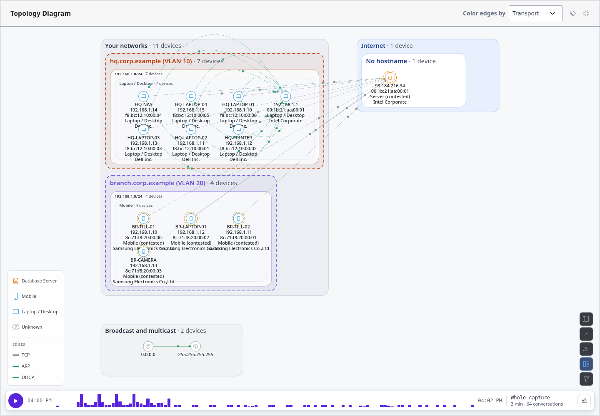
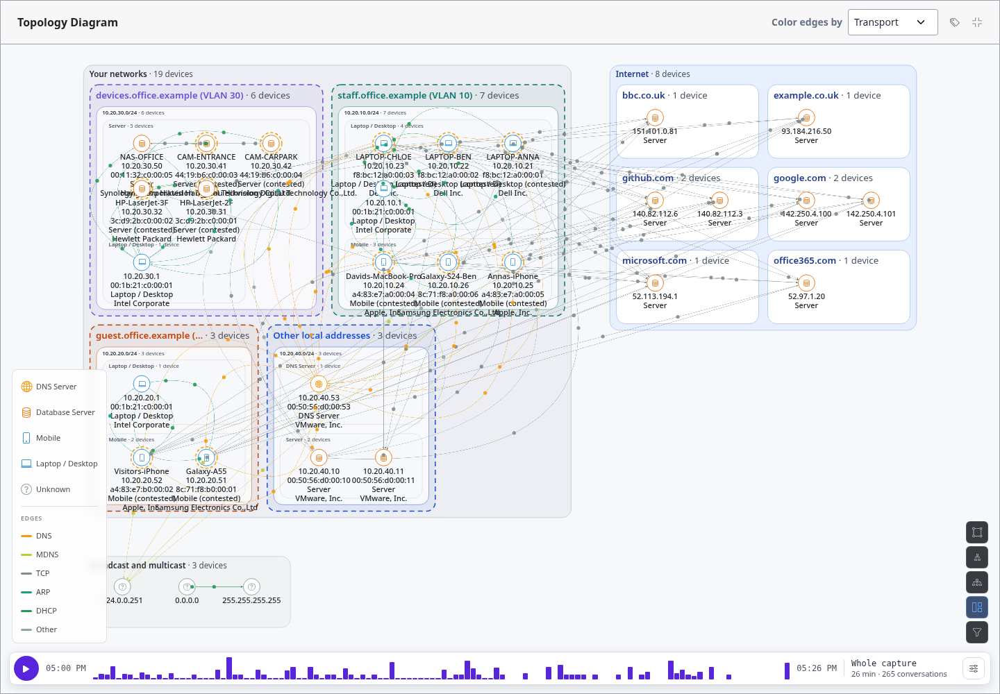
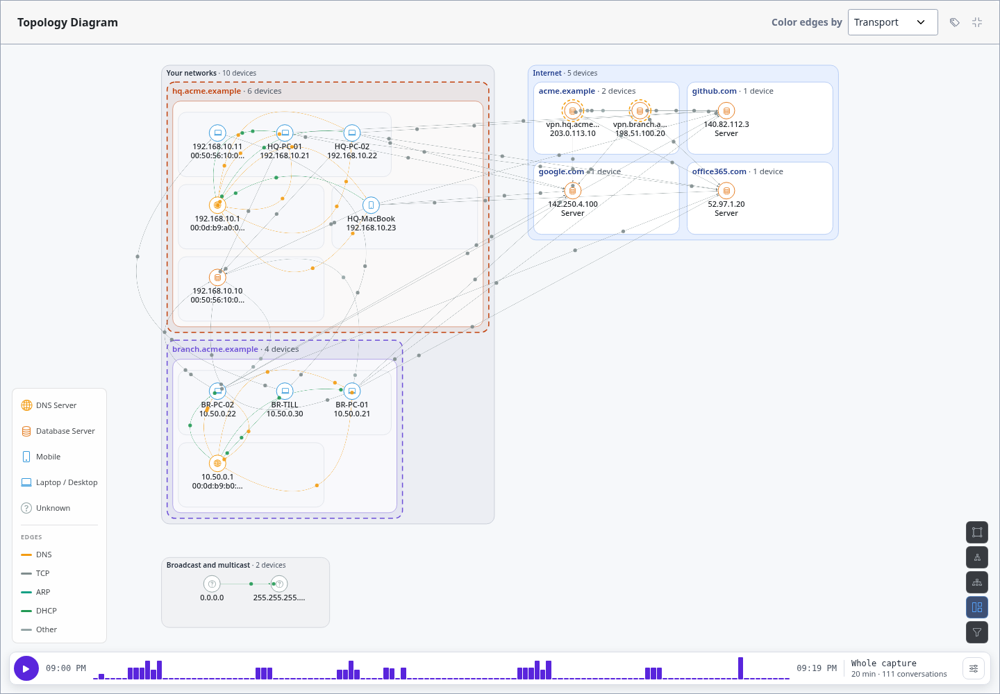
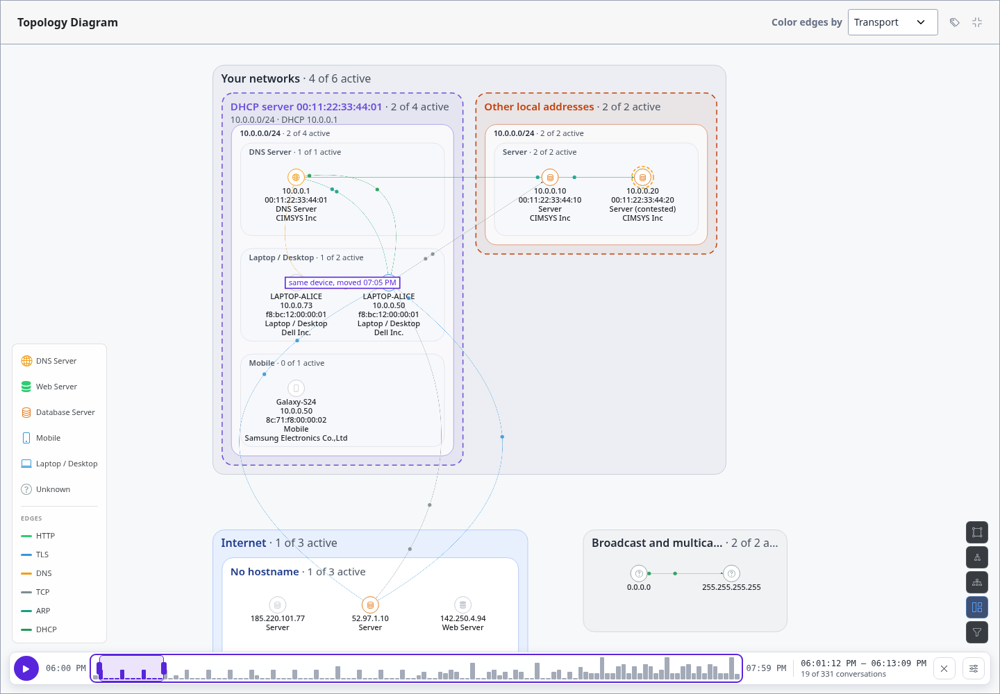

Network Map Layout
==================

The **network map** is a layout of the network graph that draws the capture the
way an analyst would by hand: devices grouped into nested boxes by where they
are, every level shown. It's the layout the Network Visualization page opens
in; the layout controls (bottom right) switch to circular or hierarchical and
back. The compare page and the monitor's snapshot dialog open in circular.

         hq.corp.example (VLAN 10) and branch.corp.example (VLAN 20), each with its 192.168.1.0/24
         subnet and device-type groups; Internet and Broadcast and multicast sit beside it.

   ``two_sites_one_range.pcap``: two sites on the same range, each in its own box.

The Levels
----------

Each box sits inside the one above it:

- **Your networks**: local addresses (private ranges, plus your
  :doc:`custom private ranges <network-address-config>`).

  - **Network**: a network TracePcap found from DHCP and VLANs (see
    :doc:`overlapping-networks`), named by its DHCP domain and VLAN, with its
    range, gateway and DHCP server under the name. Local devices that no
    found network accounts for are in **Other local addresses** (or **Local
    network** when the capture has no DHCP at all). A statically addressed
    host (a server, a printer) joins the network whose range holds its
    address, when exactly one network has that range.

    - **Subnet**: the /24 (IPv4) or /64 (IPv6).

      - **Device type**: the device's classification (Laptop / Desktop,
        Mobile, Server…), or **Unclassified**.

- **Internet**: public addresses, grouped by **domain** (``cdn.example.com``
  and ``www.example.com`` share ``example.com``). The domain comes from the
  host's name, else from the name clients looked its address up by in the
  capture's DNS traffic; with neither, **No hostname**.
- **Broadcast and multicast**: ``0.0.0.0``, ``255.255.255.255`` and multicast
  addresses.

Device labels are fitted to their cell, so neighbours never overlap: with the
whole map in view a device shows its first lines (name and address), cut to fit,
and zooming in shows the rest. Hover a device to read all of it.

Each network has its own colour. A router that serves several networks from one
MAC address shows once per network: each of its addresses goes in the network
whose range holds it. A box's name shows how many devices it holds;
when it's too small to read at the current zoom, it's left out until you zoom
in. Two networks that use the same range stay apart: a device on the second one
is placed by its device key, else by its MAC.

Trying It Out
-------------

``sample-files/small_office.pcap`` (made by ``gen_small_office.py``) fills every
level: three DHCP networks (staff, devices, guest), a statically addressed
server network, internet hosts named by DNS lookups, traffic between the
networks, and 26 minutes for the time axis to play (the cameras start at 5
minutes, a visitor's phone joins at 15).

         subnets and device-type groups, Other local addresses holding the servers, and the
         internet grouped into bbc.co.uk, example.co.uk, github.com, google.com, microsoft.com
         and office365.com.

   ``small_office.pcap``.

``sample-files/site_to_site_vpn.pcap`` (``gen_site_to_site_vpn.py``) is two
offices joined over the internet: each LAN sits behind a gateway that runs DHCP,
DNS and NAT, and the gateways run a WireGuard tunnel between their public
addresses. On the map the two offices are side by side under *Your networks*;
the gateways' public addresses sit together in the Internet box (named by
reverse DNS, so both fall under ``acme.example``), joined by the tunnel; long
edges run from Branch's PCs and till to the HQ file and ERP servers (the traffic
inside the tunnel, captured on each LAN); and each public address fans out to
the sites the offices browse. A gateway's inside and outside addresses are
separate devices on the map: nothing in the capture ties them together.

         Your networks, the two gateways' public addresses together under acme.example in the
         Internet box, and edges from the Branch devices to the HQ servers.

   ``site_to_site_vpn.pcap``.

With the Time Axis
------------------

The layout works with :doc:`network-time-axis`. With a window set, devices
outside it go grey in place and each box counts what's active, such as *2 of 4
active*.

         4 of 6 active, 1 of 3 active and so on, and quiet devices are greyed out.

   Early in ``dhcp_address_reuse.pcap``: the phone hasn't been active yet.

Edges, the traffic animation and the same-device links of :doc:`device-moves`
draw as in the other layouts.

Moving Devices
--------------

Drag a device to move it, for a screenshot or to untangle a corner; its boxes
stay where they are. **Reset positions** (the arrow among the layout controls,
shown once something has been dragged) puts every device back in its place.
Positions aren't saved yet: changing a filter or the layout, or reloading,
lays the map out afresh.
