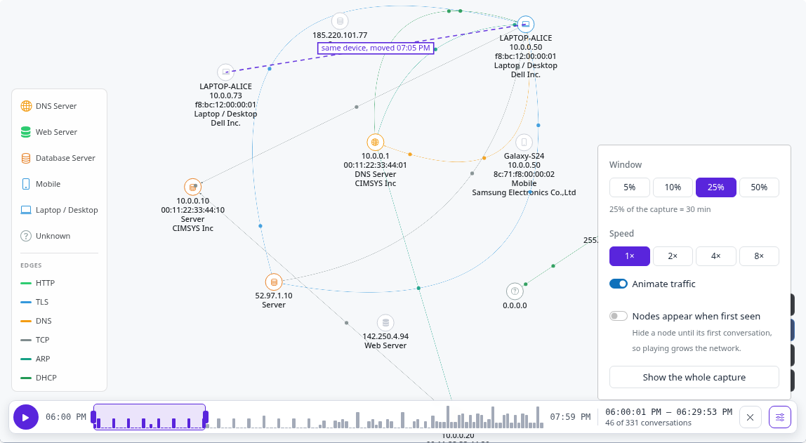
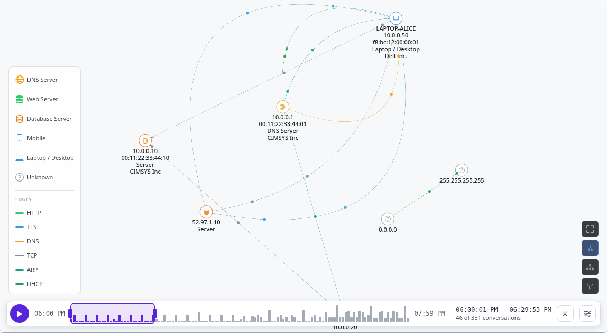

Network Traffic Over Time
=========================

The network graph shows every conversation in a capture at once. The **time
axis** above it shows the traffic over the capture, and picks a window of it:
the graph then shows only what happened in that window, so you can watch hosts
come and go, see when a conversation started, and follow a device through the
capture.

The Time Axis
-------------

A bar along the bottom of the graph, inside it, so it stays there in fullscreen:

         window over the first quarter, the window's times and conversation count, a reset button
         and the settings button, whose popover shows window width, speed, Animate traffic, Nodes
         appear when first seen, and Show the whole capture.

   The bar, with its settings open.

- **The chart** is the capture's traffic: bytes per interval from its first to
  its last conversation, each conversation's bytes spread over its duration. The
  shaded box on it is the **window**:

  - drag the box to move it, or drag its edges to resize it;
  - click anywhere else on the chart to centre the window there;
  - from the keyboard (it's a slider): ← and → move the window, Shift moves it
    further, Home and End jump to the ends, Escape shows the whole capture.

- **Play** slides the window from where it is to the end of the capture.
  **Pause** stops it.
- The **readout** gives the window's times and how many conversations were
  active in it. **×** next to it shows the whole capture again.
- **Settings** (the sliders button):

  - **Window** width: 5% to 50% of the capture, with how long that is;
  - **Speed**: 1× crosses the whole capture in about 30 seconds, up to 8×;
  - **Animate traffic** (below);
  - **Nodes appear when first seen** (below);
  - **Show the whole capture**: no window at all, so every node and
    conversation is shown, as without the time axis.

Traffic Dots
------------

With **Animate traffic** on (the default, unless your system asks for reduced
motion), dots move along every edge shown, in the edge's colour:

- **More dots** on busier conversations: one for a trickle, up to four for the
  heaviest.
- **Both ways** when the conversation went both ways: every other dot runs back.
- They follow the edge's own shape, curved or straight, and only edges in the
  time window (and not hidden by hovering a node) have them.

Played together, the window and the dots show traffic starting, moving and
stopping over the capture. On a very large graph only the 400 busiest edges
animate, so it stays smooth. Animation stops while the browser tab is hidden.

Nodes Appearing When First Seen
-------------------------------

Off by default. On, a node is hidden until its first conversation has started:
with the window early in the capture, devices that only turn up later aren't on
the graph yet, and playing it shows the network growing. Once a node has
appeared, it stays, greyed out while it's quiet. A same-device link (see
:doc:`device-moves`) shows once both its nodes have appeared.

         10.0.0.50 and its peers are drawn; the phone and the laptop's later address aren't there yet.

   Early in ``dhcp_address_reuse.pcap``: the phone and ``10.0.0.73`` haven't appeared yet.

What the Window Does
--------------------

- **Edges** are shown only for conversations active in the window: started
  before it ends and not ended before it starts.
- **Nodes** with no conversation in the window are greyed out but stay where they
  are, so the layout doesn't jump as the window moves. Their labels stay, so a
  quiet host is still findable.
- **Node-to-Node Volume** below the graph counts only the window's
  conversations.
- The window works on top of the graph's other filters (protocol, application,
  risks and so on): the chart shows the filtered traffic, and the window picks
  from it.

A conversation's time is when it started and ended. A long-lived one, such as a
router's periodic ARP, stays active in every window it spans.

Example
-------

An address that changed hands (see :doc:`address-reuse`) shows its devices in
turn: early in ``dhcp_address_reuse.pcap`` only Alice's laptop on ``10.0.0.50``
is active; late in it, the visitor's phone and its beaconing are, and the laptop
is greyed out. :doc:`../demos/devices-on-a-dhcp-network` walks through it.
