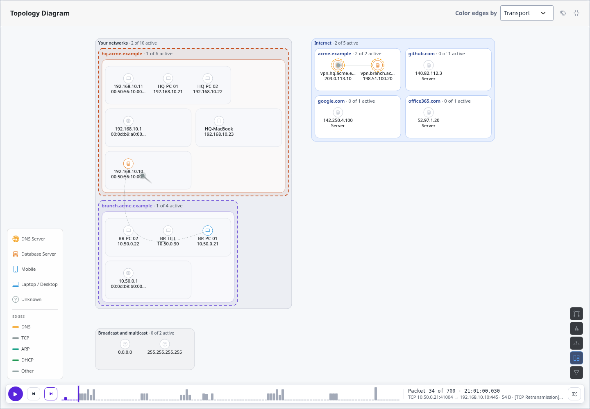

Packet Replay
=============

**Packet replay** plays a capture back on the network graph one packet at a
time: each packet flies along its conversation's edge, from sender to receiver,
in its protocol's colour, and a ring opens where it lands. Where the
:doc:`network-time-axis` slides a window over conversations, replay shows the
individual packets inside them.

Turn it on from the time axis's settings (the sliders button on its bar):
**Play by** › **Packet by packet**. Choose **Time window** there to go back.

         lands on the HQ file server, the two gateways' public addresses are active, and the bar
         reads Packet 34 of 700 with the packet's summary.

   ``site_to_site_vpn.pcap``: a Branch PC opens a connection to the HQ file server through the
   tunnel.

Moments
-------

Replay steps by **moment**: every packet captured within the same millisecond.
A broadcast, a multicast answered by several hosts, or a burst sent at once
plays as one step, all its packets flying together; the next step is the next
instant anything happened, however long the gap.

The Replay Bar
--------------

- **Play** steps through moments on its own; **Speed** in the settings sets
  how many moments a second (1, 2, 5, 10 or 25).
- **Previous** and **Next** step one moment by hand.
- **The chart** shows the capture's traffic, with a playhead at the current
  moment: click or drag to jump there. From the keyboard it's a slider:
  arrows step a moment (Shift: ten), Home and End jump to the start and end.
- **The readout** gives the packet numbers, the time to the millisecond, and
  what the packet is, from the dissector: ``TCP 10.50.0.21:41004 →
  192.168.10.10:445 · 54 B · [SYN] …``, or for several at once ``3 packets at
  once: DNS ×2, ARP``. Packets whose conversation is filtered off the graph are
  counted (*2 not on the graph*) but don't fly.

While replaying, the graph shows the current instant: the conversations open at
that moment are drawn and the rest are greyed out, as with a very narrow time
window. **Nodes appear when first seen** works here too, so stepping from the
start grows the network packet by packet, and in the :doc:`network-map` each
box counts its active devices.

Limits
------

Replay reads the packets TracePcap stored at analysis. With
``PACKET_RETENTION_HOURS`` set (see :doc:`../configuration/environment-variables`),
a capture's packets are pruned after that long to save space while its
conversations stay; replay isn't available for it then, and the bar says so.
